# 02. Architecture & Technology Stack

## High-Level System Architecture

Tender Tracker is architected as an integrated single-process Node.js application pairing an Express REST/SSE backend with a React 19 single-page application (SPA) bundled via Vite. The server orchestrates self-healing crawling routines, database transactions, background schedulers, document retrieval, multi-model AI extraction, and Playwright automation, while the client renders a responsive operational cockpit.

```mermaid
graph TD
    subgraph Client [Browser Client: React 19 + Tailwind v4]
        AppShell[App.tsx: Root State & SSE Subscriber]
        KpiBanner[KpiHeader.tsx: Metrics, HITL & Corrigenda Alerts]
        Inbox[InboxScreen.tsx & src/components/inbox/: Detail, AddTenderModal, TenderRow, DeadlineRunway]
        Pipeline[PipelineScreen.tsx: Kanban Board & 5-Week Gantt]
        Sources[SourcesScreen.tsx: Keywords, Portals & Data Mgmt]
    end

    subgraph Server [Backend Engine: Express on Node 20/24]
        API[src/server/routes/*.routes.ts: Modular REST & Dossier Endpoints]
        SSEHub[SSE Stream /api/scan/progress]
        Scheduler[scheduler.ts: Cron, Retention & Ingest Worker Trigger]
        Crawler[crawlerEngine.ts: Thin Scan Orchestrator & Facade]
        IngestPipeline[ingestPipeline.ts: Dedup, Staging, Rescan & Ingestion Decisions]
        PortalParsers[portalParsers.ts: Multi-Pattern DOM, Table & Layout Parsing]
        HTMLFetcher[htmlFetcher.ts: Redirect-Aware & Charset-Decoded HTTP]
        TenderAnalysis[tenderAnalysis.ts: Single-Tender Detail & On-Demand AI Analysis]
        Healer[healer.ts: 7-Rule Guarded URL Healer & Link Scorer]
        DocExtractor[documentExtractor.ts: Local PDF/DOCX + Budgeted Vision]
        IngestWorker[ingestWorker.ts & ingestBudget.ts: Durable Retry Queue]
        Deduplicator[deduplicator.ts: 3-Tier Ref, Bigram & MiniLM Matcher]
        Embedding[embeddingService.ts: 384-D MiniLM & Tagged Vector Spaces]
        DossierMgr[dossierManager.ts & dossierStore.ts: Abortable Cache & Reconciler]
        Repos[src/server/db/repositories/*.ts: Strict SQLite Repository Layer]
        OCR[ocrService.ts: 4-Model Gemini Pool & JSON Repair]
        BrowserEngine[playwrightEngine.ts & portalAuth.ts]
    end

    subgraph Storage [Local Persistence Layer]
        DB[(SQLite WAL: data/tender_tracker.db)]
        DossierStorage[data/dossiers/]
        SessionStorage[data/sessions/]
        BackupStorage[data/backups/]
    end

    subgraph External [External Web & AI Services]
        GovPortals[18 Pakistan Procurement Portals]
        GeminiAPI[Google AI Studio: 4-Model Failover Pool]
    end

    AppShell -->|REST Fetch| API
    AppShell -->|EventSource| SSEHub
    Inbox -->|Trigger AI / Upload / Triage| API
    Pipeline -->|Stage Transition / Notes| API
    Sources -->|Edit Portal / Retry Scan / Backup| API

    API --> DB
    API --> Crawler
    API --> OCR
    API --> BrowserEngine
    Scheduler --> Crawler
    Crawler -->|Broadcast Progress| SSEHub
    Crawler -->|Fetch & Parse| GovPortals
    Crawler -->|On HTTP 404/410/500 only| Healer
    Healer -->|Root Probe & Nav Scoring| GovPortals
    Healer <-->|Link Discovery & DOM Extraction| OCR
    Healer -->|Save Healed URL| DB
    Crawler --> BrowserEngine
    BrowserEngine --> GovPortals
    BrowserEngine --> SessionStorage
    Crawler --> Deduplicator
    Deduplicator --> DB
    Crawler --> DossierMgr
    DossierMgr --> DossierStorage
    DossierMgr --> OCR
    OCR --> GeminiAPI
    API --> BackupStorage
```

---

## How Application Segments Communicate With Each Other

### 1. Frontend UI $\leftrightarrow$ Express REST & SSE Backend (`src/App.tsx` $\leftrightarrow$ `src/server/routes/*.routes.ts`)
- **Initial Hydration & Polling-Free Updates**:
  When `App.tsx` mounts, it fetches `/api/tenders`, `/api/kpis`, `/api/tracks`, `/api/portals`, and `/api/scan/status` in parallel, then opens a persistent `EventSource` connection to `/api/scan/progress`.
- **Real-Time Scan Telemetry**:
  Whenever `crawlerEngine.ts` updates `currentScanStatus` (portal name, completion percentage, new tenders found, corrigenda count), `broadcastProgress()` pushes a JSON frame over SSE to `App.tsx`. When `isScanning` transitions from `true` to `false`, `App.tsx` automatically re-fetches tenders, KPIs, and portal health rows so the UI updates immediately.
- **Portals Management & Error Diagnostics (`SourcesScreen.tsx`)**:
  - Displays each portal's live status badge (`Online`, `Action needed`, `Selector broken`, `Connection error`) and surfaces the exact failure cause (`Reason: <last_error_message>`) directly below the website address.
  - Provides a simplified two-field Edit Dialog (**Portal name** and **Website address**). Saving sends `PUT /api/portals/:portalId`, which updates both `tenders_url` and derived `base_url` in SQLite and clears stale error states.

### 2. Crawler Engine & Scraper Submodules (`src/server/scrapers/`)
When `startCrawlerScan()` in `crawlerEngine.ts` processes a portal via `scrapePortal(portal)`, four coordinated stages run across dedicated submodules:
1. **Stage 1 — Redirect-Aware Fetch (`src/server/scrapers/htmlFetcher.ts`)**:
   - Connects using `sslTolerantAgent` and `HUMAN_CHROME_HEADERS`, following up to 5 HTTP 301/302 redirects across domains and custom ports (such as `https://bppra.gob.pk` $\rightarrow$ `https://bpptwo.vdc.services:5451/`) and returning `{ html, finalUrl }`.
   - Portals with a `pagination` setting in `PORTAL_DEFINITIONS` are read across several listing pages, up to that portal's `maxPages` bound. The number of pages read is stored in `portal_health.pages_scanned`.
2. **Stage 2 — Deterministic Multi-Pattern DOM Parsing (`src/server/scrapers/portalParsers.ts`)**:
   - Checks for Cloudflare Turnstile / CAPTCHA challenges and unauthenticated login walls first.
   - Applies specialized extractors for NDMA (`.tender-card`), FDE (`h3.package-title`), PSDF (`.inner-advertisement-listing-box`), **BPPRA ePPS Multi-Row tables** (`tr.tender-row-main` + sibling `tr.tender-row-dates`), standard Drupal/GridView tables, and WordPress PDF directories.
3. **Stage 3 — Adaptive AI HTML Layout Extraction (`src/server/scrapers/portalParsers.ts`)**:
   - If deterministic selectors return `0` items on an HTTP 200 page that has procurement signal words (`tender`, `procurement`, `rfp`, `bid`, `nit`, `deadline`) and is not an explicit empty table (`"No active tenders"`), `compactHtmlForAiExtraction()` strips scripts/styles/menus while converting `<a href="...">Label</a>` into inline `[Label](resolvedUrl)` markdown.
   - Sends the compacted digest to `extractTenderListFromHtmlWithAI()` in `ocrService.ts` to extract structured `RawScrapedItem[]` records.
4. **Stage 4 — Guarded Autonomous URL Healer (`src/server/scrapers/healer.ts`)**:
   - Governed by the **7 Anti-Corruption Rules** (`AGENTS.md §2`): triggered strictly on dead-link HTTP 404/410/500 errors or manual operator request (`POST /api/portals/:id/heal`), and **never** on HTTP 200 0-item scans, TLS resets, or network timeouts.
   - Enforces registrable domain boundaries, anti-downgrade path guards, clean origin `base_url` normalization, and quality-verified yield proof ($\ge 2$ items, or 1 item with a closing date + reference/attachment) before persisting a healed address.

### 3. Ingestion Decisions & Pipeline Ingestion (`src/server/scrapers/ingestPipeline.ts`)
**Re-scan path first.** Before anything else, `processAndSaveTender` computes the deterministic tender id (`computeTenderId`) and checks whether that tender is already stored. If it is, the item goes through `applyRescanToExistingTender`: the row is never switched back to `staging`, never deleted, and its pipeline stage and operator notes are never overwritten. Only new items continue through the steps below. On-demand AI document analysis is isolated in `src/server/scrapers/tenderAnalysis.ts`. Full rules are in [`06-pipeline-and-workflow.md`](./06-pipeline-and-workflow.md).

1. **Hybrid Track Matching (`matchTracks` & `embeddingService.ts`)**:
   - Evaluates each scraped item against active `domain_tracks` using positive/negative keywords and 384-dimensional `all-MiniLM-L6-v2` semantic embeddings (`model`-tagged vs `fast`-tagged vector spaces are never mixed).
2. **3-Tier Canonical Deduplication (`src/server/deduplicator.ts`)**:
   - Checks `findCanonicalMatch()` across Tier 1 (normalized `reference_no`), Tier 2 ($\ge 0.85$ bigram Dice-coefficient title similarity within 1.5 days), and Tier 3 (same-space semantic vector cosine similarity).
   - Tier 2 and Tier 3 similarity matching only considers tenders from other portals; a tender's own portal is excluded from the candidate search.
   - On a duplicate match: the other portal is appended to `secondary_sources` and any new document links are queued for the background worker.
   - The stored deadline may change only when the listing is known to describe the same tender: the same source, or a Tier 1 reference-number match (rule `A4`). In that case `applyRescannedDeadline` logs a `deadline_extension` corrigendum if the scanned deadline falls on a later PKT calendar day, and flags `needs_review = 1` (`deadline_moved_earlier`) if it falls on an earlier day, keeping the stored deadline. A Tier 2 or Tier 3 similarity match never changes the deadline; its date is only recorded on the secondary source.
3. **Staging & Upfront Document Verification (`processAndSaveTender` & `documentExtractor.ts`)**:
   - When a tender is undated or its `direct_url` is a direct document and the scan has upfront time budget remaining (`ingestBudget.ts`), the row is first inserted with `ingestion_status = 'staging'` (hidden from Inbox/Pipeline/KPI queries via `NOT_STAGING_SQL`).
   - A listing that matches no active domain track but has documents attached is held as `ingestion_status = 'awaiting_scope'` (also hidden). Once the worker has read its documents it is released to `ready` if a track matches, or deleted with `reason = 'no-track-match'` if none does. Unresolved rows are purged by retention after 3 days.
   - Up to 2 priority-sorted documents (corrigenda first, then RFPs/notices) are downloaded with an `AbortSignal` timeout and streaming `maxFileBytes` cap (`dossierManager.ts`) and read locally first via `pdfjs-dist` / `mammoth` (`documentExtractor.ts`). Gemini Vision is invoked only for scanned/image documents within the scan's Vision call cap.
   - `resolveCanonicalDeadline()` reconciles listing and document deadlines (recording `deadline_source` and `deadline_confidence`), re-scores domain tracks against extracted scope text, and applies Rules `B6` (past deadline), `B6b` (>90-day undated notice), and `B6c` (prior-year-only references). Rejected staging rows are deleted via `deleteStagedTender()` and recorded in `deleted_tenders`; passing rows are promoted to `ingestion_status = 'ready'`.
4. **Durable Background Document Queue (`ingestWorker.ts` & `ingestJobsRepo.ts`)**:
   - Dated tenders' attachments, remaining documents beyond the upfront cap, timed-out downloads, and scanned documents deferred by the per-scan Vision cap are enqueued in `document_ingest_jobs` (plus persisted in `tenders.attachment_urls`).
   - Every 2 minutes (when no scan is active), `processDocumentQueue()` claims ready jobs with a 5-minute lease, downloads and extracts documents, updates deadlines/provenance/descriptions, and retries transient failures with 2 $\rightarrow$ 10 $\rightarrow$ 30 minute backoff.

---

## Technology Stack

### Runtime & Core Frameworks
- **Runtime**: Node.js v20+ / v24.
- **Backend Framework**: Express v4 (`server.ts`, modularized via `createApp()`).
- **Frontend Framework**: React v19 with React DOM.
- **Build Tool**: Vite v8 with `@vitejs/plugin-react` and `@tailwindcss/vite`.
- **Styling**: Tailwind CSS v4 using semantic design tokens defined in `src/index.css` and `src/theme.ts`.
- **Icons**: Lucide React.
- **Language**: TypeScript v5 throughout client, server, and test suites.

### Data & Persistence
- **Database**: SQLite 3 using `better-sqlite3`.
- **Journal Mode**: Write-Ahead Logging (`PRAGMA journal_mode = WAL`) for concurrent reads and writes without blocking.
- **Schema & Migrations**: Programmatic, idempotent guarded `ALTER TABLE` schema updates and `app_settings` initialization in `src/server/db/schema.ts` (`src/server/db.ts` remains only as a one-line re-export of `src/server/db/index.ts`).

### Scraping, Automation & AI
- **HTML Parsing**: `cheerio` for fast, lightweight DOM parsing and link-preserving HTML compaction.
- **HTTP Client**: Redirect-aware tolerant HTTPS/HTTP agents (`fetchHtmlWithMetadata`) with 15s timeouts, realistic Chrome header masquerading, and unverified TLS bypass for legacy government SSL certificates.
- **Browser Automation**: Playwright Chromium for rendering dynamic SPA portals (e.g., Sindh SPPRA) and interactive HITL Cloudflare bypass.
- **AI Engine (`src/server/ocrService.ts`)**: `@google/genai` configured with a cached client (`20s` timeout) and a **4-Model Failover Chain** (`gemini-flash-lite-latest` $\rightarrow$ `gemini-3.1-flash-lite` $\rightarrow$ `gemini-3.5-flash` $\rightarrow$ `gemini-3.8-flash`) plus a self-healing JSON repair parser (`parseAndRepairTenderJson`).

---

## Data Boundary & Security Isolation

- **Production Directory (`data/`)**: Contains live operational database `tender_tracker.db`, dossier downloads, serialized session cookies, and database backups.
- **Sample Directory (`data-sample/`)**: Isolated environment populated by `npm run seed:sample` for demonstration and preview.
- **Automated Test Isolation**: Tests enforce `TENDER_DATA_DIR` pointing to temporary isolated folders (`AppData/Local/Temp/tt-suite-temp-*`). The setup guard throws an immediate exception if a test attempts to bind to the root production `data/` directory.
- **Loopback Binding**: By default, `server.ts` binds strictly to `127.0.0.1` (`HOST=127.0.0.1`), preventing exposure on public network interfaces.
