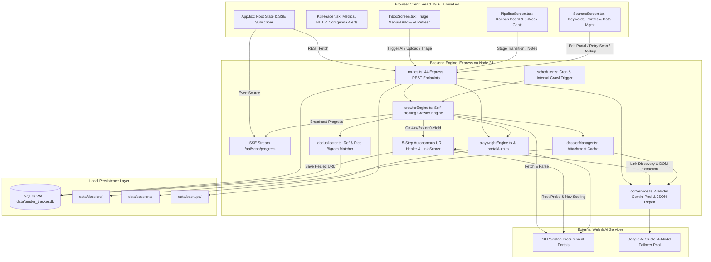

# 02. Architecture & Technology Stack

## High-Level System Architecture

Tender Tracker is architected as an integrated single-process Node.js application pairing an Express REST/SSE backend with a React 19 single-page application (SPA) bundled via Vite. The server orchestrates self-healing crawling routines, database transactions, background schedulers, document retrieval, multi-model AI extraction, and Playwright automation, while the client renders a responsive operational cockpit.

---

## How Application Segments Communicate With Each Other

### 1. Frontend UI $\leftrightarrow$ Express REST & SSE Backend (`src/App.tsx` $\leftrightarrow$ `src/server/routes.ts`)
- **Initial Hydration & Polling-Free Updates**:
  When `App.tsx` mounts, it fetches `/api/tenders`, `/api/kpis`, `/api/tracks`, `/api/portals`, and `/api/scan/status` in parallel, then opens a persistent `EventSource` connection to `/api/scan/progress`.
- **Real-Time Scan Telemetry**:
  Whenever `crawlerEngine.ts` updates `currentScanStatus` (portal name, completion percentage, new tenders found, corrigenda count), `broadcastProgress()` pushes a JSON frame over SSE to `App.tsx`. When `isScanning` transitions from `true` to `false`, `App.tsx` automatically re-fetches tenders, KPIs, and portal health rows so the UI updates immediately.
- **Portals Management & Error Diagnostics (`SourcesScreen.tsx`)**:
  - Displays each portal's live status badge (`Online`, `Action needed`, `Selector broken`, `Connection error`) and surfaces the exact failure cause (`Reason: <last_error_message>`) directly below the website address.
  - Provides a simplified two-field Edit Dialog (**Portal name** and **Website address**). Saving sends `PUT /api/portals/:portalId`, which updates both `tenders_url` and derived `base_url` in SQLite and clears stale error states.

### 2. Crawler Engine $\leftrightarrow$ Self-Healing Pipeline (`src/server/scrapers/crawlerEngine.ts`)
When `startCrawlerScan()` processes a portal via `scrapePortal(portal)`, four coordinated stages run:
1. **Stage 1 — Redirect-Aware Fetch (`fetchHtmlWithMetadata`)**:
   - Connects using `sslTolerantAgent` and `HUMAN_CHROME_HEADERS`, following up to 5 HTTP 301/302 redirects across domains and custom ports (such as `https://bppra.gob.pk` $\rightarrow$ `https://bpptwo.vdc.services:5451/`) and returning `{ html, finalUrl }`.
2. **Stage 2 — Deterministic Multi-Pattern DOM Parsing (`parsePortalHtml`)**:
   - Checks for Cloudflare Turnstile / CAPTCHA challenges and unauthenticated login walls first.
   - Applies specialized extractors for NDMA (`.tender-card`), FDE (`h3.package-title`), PSDF (`.inner-advertisement-listing-box`), **BPPRA ePPS Multi-Row tables** (`tr.tender-row-main` + sibling `tr.tender-row-dates`), standard Drupal/GridView tables, and WordPress PDF directories.
3. **Stage 3 — Adaptive AI HTML Layout Extraction (Phase 2 Zero-Yield Recovery)**:
   - If deterministic selectors return `0` items on an HTTP 200 page that has procurement signal words (`tender`, `procurement`, `rfp`, `bid`, `nit`, `deadline`) and is not an explicit empty table (`"No active tenders"`), `compactHtmlForAiExtraction()` strips scripts/styles/menus while converting `<a href="...">Label</a>` into inline `[Label](resolvedUrl)` markdown.
   - Sends the compacted digest to `extractTenderListFromHtmlWithAI()` in `ocrService.ts` to extract structured `RawScrapedItem[]` records.
4. **Stage 4 — 5-Step Autonomous URL Healer (`healPortalConnection`)**:
   - Triggered automatically whenever `portal.tendersUrl` fails with an HTTP error (e.g., `HTTP 500` or `HTTP 404`) or yields `0` items on a non-tender landing page:
     1. **Step 1 & 2 (Organization Root & Redirect Resolution)**: Probes `portal.baseUrl` (and URL origin), following redirects to capture `finalRootUrl`.
     2. **Step 3 (Look for the Tenders Button)**: `scoreCandidateTenderLinks()` scores all homepage `<a href>` links based on anchor text (`Tenders`, `Active Tenders`, `Procurement`, `Bids`, `RFP`, `NIT`) and URL path slugs while penalizing archive, rules, and social links. If no link scores $\ge 5$, falls back to `discoverTenderLinkWithAI()`.
     3. **Step 4 (Open & Verify Candidate Portal)**: Fetches the top candidate URLs and runs `parsePortalHtml()` (plus AI layout fallback) to verify that genuine tender listings or a valid tender table exist.
     4. **Step 5 (Save Healed Portal Address)**: Persists the verified `base_url` and `tenders_url` into SQLite `portal_health` (`status: 'online'`, `verified_status: 'Auto-healed -> <url>'`) and returns the scraped items to the scan loop.

### 3. Crawler Engine $\leftrightarrow$ Deduplicator, Dossier Manager & AI Service
1. **Track Matching (`matchesDomainTracks`)**:
   - Matches each scraped item against active `domain_tracks` using positive and negative keywords while excluding the portal's own default name from false-positive matches.
2. **Canonical Deduplication (`src/server/deduplicator.ts`)**:
   - Checks `findCanonicalMatch()` using normalized `reference_no` or $\ge 0.85$ bigram Dice-coefficient title similarity.
   - If a match exists, records a secondary source link (`tender_sources`) and logs a corrigendum in `corrigendum_logs` if the closing date changed.
3. **Background Dossier Caching & Multimodal OCR (`src/server/dossierManager.ts` & `src/server/ocrService.ts`)**:
   - Downloads attached PDFs and notice images into `data/dossiers/<tenderId>/`.
   - If a tender is missing its reference number, closing deadline, or detailed scope summary, automatically invokes `extractTenderFromImage()` on downloaded notice scans/PDFs and updates the SQLite tender record via `updateTenderFields()`.

---

## Technology Stack

### Runtime & Core Frameworks
- **Runtime**: Node.js v20+ / v24.
- **Backend Framework**: Express v4 (`server.ts`, modularized via `createApp()`).
- **Frontend Framework**: React v19 with React DOM.
- **Build Tool**: Vite v8 with `@vitejs/plugin-react` and `@tailwindcss/vite`.
- **Styling**: Tailwind CSS v4 using semantic design tokens defined in `src/index.css` and `src/theme.ts`.
- **Icons**: Lucide React.
- **Language**: TypeScript v5 throughout client, server, and test suites.

### Data & Persistence
- **Database**: SQLite 3 using `better-sqlite3`.
- **Journal Mode**: Write-Ahead Logging (`PRAGMA journal_mode = WAL`) for concurrent reads and writes without blocking.
- **Schema & Migrations**: Programmatic, idempotent guarded `ALTER TABLE` schema updates and `app_settings` initialization in `src/server/db.ts`.

### Scraping, Automation & AI
- **HTML Parsing**: `cheerio` for fast, lightweight DOM parsing and link-preserving HTML compaction.
- **HTTP Client**: Redirect-aware tolerant HTTPS/HTTP agents (`fetchHtmlWithMetadata`) with 15s timeouts, realistic Chrome header masquerading, and unverified TLS bypass for legacy government SSL certificates.
- **Browser Automation**: Playwright Chromium for rendering dynamic SPA portals (e.g., Sindh SPPRA) and interactive HITL Cloudflare bypass.
- **AI Engine (`src/server/ocrService.ts`)**: `@google/genai` configured with a cached client (`20s` timeout) and a **4-Model Failover Chain** (`gemini-flash-lite-latest` $\rightarrow$ `gemini-3.1-flash-lite` $\rightarrow$ `gemini-3.5-flash` $\rightarrow$ `gemini-3.8-flash`) plus a self-healing JSON repair parser (`parseAndRepairTenderJson`).

---

## Data Boundary & Security Isolation

- **Production Directory (`data/`)**: Contains live operational database `tender_tracker.db`, dossier downloads, serialized session cookies, and database backups.
- **Sample Directory (`data-sample/`)**: Isolated environment populated by `npm run seed:sample` for demonstration and preview.
- **Automated Test Isolation**: Tests enforce `TENDER_DATA_DIR` pointing to temporary isolated folders (`AppData/Local/Temp/tt-suite-temp-*`). The setup guard throws an immediate exception if a test attempts to bind to the root production `data/` directory.
- **Loopback Binding**: By default, `server.ts` binds strictly to `127.0.0.1` (`HOST=127.0.0.1`), preventing exposure on public network interfaces.
