# 02. Architecture & Technology Stack

## High-Level System Architecture

Tender Tracker is architected as an integrated single-process Node.js application pairing an Express REST/SSE backend with a React 19 single-page application (SPA) bundled via Vite. The server orchestrates self-healing crawling routines, database transactions, background schedulers, document retrieval, multi-model AI extraction, and Playwright automation, while the client renders a responsive operational cockpit.

```mermaid
graph TD
    subgraph Client [Browser Client: React 19 + Tailwind v4]
        AppShell[App.tsx & AppShell.tsx: Root State, Sidebar Network Status & SSE]
        KpiBanner[KpiHeader.tsx: Metrics, HITL & Corrigenda Alerts]
        Inbox[InboxScreen.tsx & src/client/components/inbox/: Detail, AddTenderModal, TenderRow, DeadlineRunway]
        Pipeline[PipelineScreen.tsx: Kanban Board & 5-Week Gantt]
        Sources[SourcesScreen.tsx: Keywords, Portals & Data Mgmt]
    end

    subgraph Server [Backend Engine: Express on Node 22+]
        API["src/server/routes/*.routes.ts: Modular REST, Auth & Digest API"]
        SSEHub[SSE Stream /api/scan/stream & /api/scan/progress]
        Scheduler[scheduler.ts & retention.ts: Cron, Digest, Retention & Worker Trigger]
        NetworkMonitor[networkMonitor.ts: Connectivity Health & Task Gating]
        Crawler[crawlerEngine.ts & baseScraper.ts: Scan Orchestrator & Worker Pool]
        IngestPipeline[ingestPipeline.ts: Dedup, Staging, Rescan & Ingestion Decisions]
        PortalParsers[portalParsers.ts, dateParser.ts, trackMatcher.ts & portalList.ts]
        HTMLFetcher[htmlFetcher.ts & crawlerDeps.ts: Redirect-Aware & Charset-Decoded HTTP]
        TenderAnalysis[tenderAnalysis.ts: Detail Page & On-Demand Analysis]
        Healer[healer.ts: 7-Rule Guarded URL Healer & Link Scorer]
        DocExtractor[documentExtractor.ts & documentApply.ts: Local PDF/DOCX + Vision/OCR]
        IngestWorker[ingestWorker.ts & ingestBudget.ts: Durable Retry Queue & Budgets]
        Deduplicator[deduplicator.ts & referenceNo.ts: 3-Tier Ref, Bigram & MiniLM Matcher]
        Embedding[embeddingService.ts & embeddingBackfill.ts: 384-D MiniLM Vector Spaces]
        DossierMgr[dossierManager.ts & dossierStore.ts: Abortable Cache & Reconciler]
        Repos[src/server/db/repositories/*.ts & schema.ts: Strict SQLite Repository Layer]
        OCR[ocrService.ts & localOcrService.ts: 4-Model Gemini Pool + Offline Tesseract OCR]
        URLSafety[urlSafety.ts & logger.ts: SEC-5 SSRF Guard & Secret-Redacting Logs]
        BrowserEngine[playwrightEngine.ts & portalAuth.ts]
    end

    subgraph Storage [Local Persistence Layer]
        DB[(SQLite WAL: data/tender_tracker.db)]
        DossierStorage[data/dossiers/]
        SessionStorage[data/sessions/]
        BackupStorage[data/backups/]
        RuntimeCaches[data/logs/, data/models/, data/tessdata/ & data/app-profile/]
    end

    subgraph External [External Web & AI Services]
        GovPortals[19 Pakistan Procurement Portals]
        GeminiAPI[Google AI Studio: 4-Model Failover Pool]
    end

    AppShell -->|REST Fetch & Network Check| API
    AppShell -->|EventSource| SSEHub
    Inbox -->|Trigger AI / Upload / Triage| API
    Pipeline -->|Stage Transition / Notes| API
    Sources -->|Edit Portal / Retry Scan / Backup| API

    API --> DB
    API --> Crawler
    API --> NetworkMonitor
    API --> OCR
    API --> BrowserEngine
    Scheduler --> Crawler
    Scheduler --> NetworkMonitor
    Crawler --> NetworkMonitor
    Crawler -->|Broadcast Progress| SSEHub
    Crawler -->|Fetch & Parse| GovPortals
    Crawler -->|On HTTP 404/410/500 only| Healer
    Healer -->|Root Probe & Nav Scoring| GovPortals
    Healer <-->|Link Discovery & DOM Extraction| OCR
    Healer -->|Save Healed URL| DB
    Crawler --> BrowserEngine
    BrowserEngine --> GovPortals
    BrowserEngine --> SessionStorage
    Crawler --> Deduplicator
    Deduplicator --> DB
    Crawler --> DossierMgr
    DossierMgr --> DossierStorage
    DossierMgr --> OCR
    OCR --> GeminiAPI
    API --> BackupStorage
    API -.-> RuntimeCaches
```

---

## How Application Segments Communicate With Each Other

### 1. Frontend UI $\leftrightarrow$ Express REST & SSE Backend (`src/client/App.tsx` & `src/client/components/AppShell.tsx` $\leftrightarrow$ `src/server/routes/*.routes.ts`)
- **Initial Hydration & Network Health Polling**:
  When `App.tsx` mounts, it fetches `/api/tenders`, `/api/tracks`, `/api/portals`, `/api/corrigenda`, and `/api/kpis`, polls `/api/system/network` every 60 seconds (plus on window focus, `online`/`offline` browser transitions, and manual **Recheck** via `POST /api/system/network/check`), and opens a persistent `EventSource` connection to `/api/scan/stream` (alias `/api/scan/progress`).
- **Sidebar Network Indicator & Accessible Announcements (`AppShell.tsx`)**:
  Renders live network health (`Healthy`, `Slow`, `Offline`) with shape-distinct icons, `aria-describedby` scan-button context, `forced-colors` borders, `motion-safe` animations, and centralized off-control `role="status"` / `role="alert"` live regions.
- **Real-Time Scan & Document Queue Telemetry**:
  Whenever `crawlerEngine.ts` updates `currentScanStatus` (portal name, completion percentage, new tenders found, corrigenda count, `pausedReason`, or `docQueue`), `broadcastProgress()` pushes a typed JSON frame (`scan_progress`, `doc_queue_progress`, or `documents_updated`) over SSE to `App.tsx`. When a scan finishes (`isScanning` transitions to `false`) or when `documents_updated` arrives from `drainDocumentQueue()`, `App.tsx` automatically refreshes tenders, KPIs, and corrigenda so newly cached documents appear live without a manual reload.
- **Portals Management & Error Diagnostics (`SourcesScreen.tsx`)**:
  - Displays each portal's live status badge (`Online`, `Action needed`, `Selector broken`, `Connection error`) and surfaces the exact failure cause (`Reason: <last_error_message>`) directly below the website address.
  - Provides a simplified two-field Edit Dialog (**Portal name** and **Website address**). Saving sends `PUT /api/portals/:portalId`, which updates both `tenders_url` and derived `base_url` in SQLite and clears stale error states.

### 2. Crawler Engine & Scraper Submodules (`src/server/scrapers/`)
When `startCrawlerScan()` in `crawlerEngine.ts` runs a multi-portal scan, it enforces **Two-Phase Scan Execution** (`isStatutoryPortal`): Phase 1 completes all 7 statutory boards (`epms_ppra`, `punjab_eproc`, `sppra`, `bppra`, `kppra`, `gilgit`, `ajk_ppra`) before Phase 2 scans individual agency boards (`psdf`, `pseb`, `fde`, `mofept`, `peef`, etc.). Each portal is processed via `scrapePortal(portal)` across four coordinated stages:
1. **Stage 1 — Redirect-Aware Fetch (`src/server/scrapers/htmlFetcher.ts`)**:
   - Connects using `sslTolerantAgent` and `HUMAN_CHROME_HEADERS`, following up to 5 HTTP 301/302 redirects across domains and custom ports (such as `https://bppra.gob.pk` $\rightarrow$ `https://bpptwo.vdc.services:5451/`) and returning `{ html, finalUrl }`.
   - Portals with a `pagination` setting in `PORTAL_DEFINITIONS` are read across several listing pages, up to that portal's `maxPages` bound. The number of pages read is stored in `portal_health.pages_scanned`.
2. **Stage 2 — Deterministic Multi-Pattern DOM Parsing (`src/server/scrapers/portalParsers.ts`)**:
   - Checks for Cloudflare Turnstile / CAPTCHA challenges and unauthenticated login walls first.
   - Applies specialized extractors for NDMA (`.tender-card`), FDE (`h3.package-title`), PSDF (`.inner-advertisement-listing-box`), **BPPRA ePPS Multi-Row tables** (`tr.tender-row-main` + sibling `tr.tender-row-dates`), standard Drupal/GridView tables, and WordPress PDF directories.
3. **Stage 3 — Adaptive AI HTML Layout Extraction (`src/server/scrapers/portalParsers.ts`)**:
   - If deterministic selectors return `0` items on an HTTP 200 page that has procurement signal words (`tender`, `procurement`, `rfp`, `bid`, `nit`, `deadline`) and is not an explicit empty table (`"No active tenders"`), `compactHtmlForAiExtraction()` strips scripts/styles/menus while converting `<a href="...">Label</a>` into inline `[Label](resolvedUrl)` markdown.
   - Sends the compacted digest to `extractTenderListFromHtmlWithAI()` in `ocrService.ts` to extract structured `RawScrapedItem[]` records.
4. **Stage 4 — Guarded Autonomous URL Healer (`src/server/scrapers/healer.ts`)**:
   - Governed by the **7 Anti-Corruption Rules** (`AGENTS.md §2`): triggered strictly on dead-link HTTP 404/410/500 errors or manual operator request (`POST /api/portals/:id/heal`), and **never** on HTTP 200 0-item scans, TLS resets, or network timeouts.
   - Enforces registrable domain boundaries, anti-downgrade path guards, clean origin `base_url` normalization, and quality-verified yield proof ($\ge 2$ items, or 1 item with a closing date + reference/attachment) before persisting a healed address.

### 3. Ingestion Decisions & Pipeline Ingestion (`src/server/scrapers/ingestPipeline.ts`)
**Re-scan path first.** Before anything else, `processAndSaveTender` computes the deterministic tender id (`computeTenderId`) and checks whether that tender is already stored. If it is, the item goes through `applyRescanToExistingTender`: the row is never switched back to `staging`, never deleted, and its pipeline stage and operator notes are never overwritten. Only new items continue through the steps below. On-demand AI document analysis is isolated in `src/server/scrapers/tenderAnalysis.ts`. Full rules are in [`06-pipeline-and-workflow.md`](./06-pipeline-and-workflow.md).

1. **Hybrid Track Matching (`matchTracks` & `embeddingService.ts`)**:
   - Evaluates each scraped item against active `domain_tracks` using positive/negative keywords and 384-dimensional `all-MiniLM-L6-v2` semantic embeddings (`model`-tagged vs `fast`-tagged vector spaces are never mixed).
2. **3-Tier Canonical Deduplication (`src/server/services/deduplicator.ts`)**:
   - Checks `findCanonicalMatch()` across Tier 1 (normalized `reference_no`), Tier 2 ($\ge 0.85$ bigram Dice-coefficient title similarity within 1.5 days, plus strict undated-vs-dated cross-portal matching at $\text{Dice} \ge 0.90$ with $\text{orgSim} \ge 0.50$ or $\text{Dice} \ge 0.94$ when `!titlesAreDistinguishable`), and Tier 3 (same-space semantic vector cosine similarity).
   - Tier 2 and Tier 3 similarity matching only considers tenders from other portals; a tender's own portal is excluded from the candidate search.
   - On a duplicate match: the other portal is appended to `secondary_sources` and any new document links are queued for the background worker.
   - The stored deadline may change only when the listing is known to describe the same tender: the same source, or a Tier 1 reference-number match (rule `A4`). In that case `applyRescannedDeadline` logs a `deadline_extension` corrigendum if the scanned deadline falls on a later PKT calendar day, and flags `needs_review = 1` (`deadline_moved_earlier`) if it falls on an earlier day, keeping the stored deadline. A Tier 2 or Tier 3 similarity match never changes the deadline; its date is only recorded on the secondary source.
3. **Staging & Upfront Document Verification (`processAndSaveTender` & `documentExtractor.ts`)**:
   - When a tender is undated (`!closingDate`) and has candidate documents while the scan has upfront time budget remaining (`ingestBudget.ts`), the row is first inserted with `ingestion_status = 'staging'` (hidden from Inbox/Pipeline/KPI queries via `NOT_STAGING_SQL`). Dated tenders (whether direct PDF or detail-page links) insert immediately as `'ready'` so scans stay fast without exhausting the upfront budget.
   - A listing that matches no active domain track but has documents attached is held as `ingestion_status = 'awaiting_scope'` (also hidden). Once the worker has read its documents it is released to `ready` if a track matches, or deleted with `reason = 'no-track-match'` if none does. Unresolved rows are purged by retention after 3 days.
   - Up to 2 priority-sorted documents (corrigenda first, then RFPs/notices) are downloaded with an `AbortSignal` timeout and streaming `maxFileBytes` cap (`dossierManager.ts`) and read locally first via `pdfjs-dist` / `mammoth` (`documentExtractor.ts`). Gemini Vision is invoked only for scanned/image documents within the scan's Vision call cap.
   - `resolveCanonicalDeadline()` reconciles listing and document deadlines (recording `deadline_source` and `deadline_confidence`), re-scores domain tracks against extracted scope text, and applies Rules `B6` (past deadline), `B6b` (>90-day undated notice), and `B6c` (prior-year-only references). Rejected staging rows are deleted via `deleteStagedTender()` and recorded in `deleted_tenders`; passing rows are promoted to `ingestion_status = 'ready'`.
4. **Durable Prioritized Background Document Queue (`ingestWorker.ts`, `ingestJobsRepo.ts` & `dossierStore.ts`)**:
   - Dated tenders' attachments, dedicated detail-page discovery jobs (`DETAIL_DISCOVER_LABEL` for `epms_ppra` and `fde`), remaining documents beyond the upfront cap, timed-out downloads, and scanned documents deferred by the per-scan Vision cap are enqueued in `document_ingest_jobs` (plus persisted in `tenders.attachment_urls`). Re-scans skip URLs already present in `cached_dossiers`.
   - All downloaded and uploaded documents are stored atomically via `saveTenderDocument` (`dossierStore.ts`) under the unified canonical naming rule `{PORTAL}_{Ref_or_Title}_{DocType}-{N}{-vK}.{ext}` (capped at 100 chars), classifying `docType` from URL path clues (`/BiddingDocuments/`, `/BOQManual/`, `/Tenders/`), headers, and extracted PDF headings (`inferDocTypeFromText`) with `renameDossierToCanonical`.
   - `claimDueJobs()` prioritizes tracked/bookmarked `ready` tenders first, then open Inbox (`ready`) tenders ordered by soonest closing deadline, and finally hidden `awaiting_scope` listings.
   - `drainDocumentQueue()` runs immediately after every scan finishes (`crawlerDeps.onScanFinished`), 4 seconds after startup (following idempotent `migrateDossierFilenames`, `recheckEarlierDeadlineReviewTenders`, and local `reclassifyExistingDossiersFromText`), and every 2 minutes via `scheduler.ts` (when no scan is active and network health is `online`), processing up to 3 distinct tenders concurrently (`DEFAULT_DOC_WORKER_CONCURRENCY = 3`) while keeping jobs within a single tender sequential, broadcasting live `doc_queue_progress` / `documents_updated` SSE events, and retrying transient errors with 2 $\rightarrow$ 10 $\rightarrow$ 30 minute backoff.

---

## Technology Stack

### Runtime & Core Frameworks
- **Runtime**: Node.js v22+ (LTS).
- **Backend Framework**: Express v4 (`server.ts`, modularized via `createApp()`).
- **Frontend Framework**: React v19 with React DOM.
- **Build Tool**: Vite v8 with `@vitejs/plugin-react` and `@tailwindcss/vite`.
- **Styling**: Tailwind CSS v4 using semantic design tokens defined in `src/client/index.css` and `src/client/theme.ts`.
- **Icons**: Lucide React.
- **Language**: TypeScript throughout client, server, shared types (`src/shared/types.ts`), and test suites.

### Data & Persistence
- **Database**: SQLite 3 using `better-sqlite3`.
- **Journal Mode**: Write-Ahead Logging (`PRAGMA journal_mode = WAL`) for concurrent reads and writes without blocking.
- **Schema & Migrations**: Programmatic, idempotent guarded `ALTER TABLE` schema updates and `app_settings` initialization in `src/server/db/schema.ts` (exported via `src/server/db/index.ts`).

### Full Module Inventory (Client, Shared & Server)
Every source module lives cleanly inside its designated domain directory under `src/`:
- **Client UI (`src/client/`)**: `main.tsx`, `App.tsx`, `theme.ts`, `index.css`, `ui/index.tsx` (design primitives), top-level screens/chrome (`components/AppShell.tsx`, `components/KpiHeader.tsx`, `components/InboxScreen.tsx`, `components/PipelineScreen.tsx`, `components/SourcesScreen.tsx`, `components/PortalCredentialsModal.tsx`), pipeline modal (`components/pipeline/PassConfirmModal.tsx`), and Inbox submodules (`components/inbox/Detail.tsx`, `AddTenderModal.tsx`, `TenderRow.tsx`, `DeadlineRunway.tsx`, `DeleteTenderModal.tsx`, `HighlightedDescription.tsx`, `PortalPills.tsx`, `index.ts`).
- **Shared (`src/shared/`)**: `types.ts` (isomorphic TypeScript domain types shared between React client and Express server), `pktDate.ts` (canonical PKT `YYYY-MM-DD` calendar-day helper).
- **Database (`src/server/db/`)**: `connection.ts`, `schema.ts`, `index.ts`, and domain repositories `repositories/tendersRepo.ts`, `repositories/portalsRepo.ts`, `repositories/tracksRepo.ts`, `repositories/systemRepo.ts`, `repositories/ingestJobsRepo.ts`.
- **Routes (`src/server/routes/`)**: `index.ts` mounting `tenders.routes.ts`, `portals.routes.ts`, `tracks.routes.ts`, `scan.routes.ts`, and `system.routes.ts` (plus `routeUtils.ts` async error forwarding).
- **Scrapers (`src/server/scrapers/`)**: `baseScraper.ts`, `bppraScraper.ts`, `crawlerDeps.ts`, `crawlerEngine.ts`, `dateParser.ts`, `healer.ts`, `htmlFetcher.ts`, `ingestPipeline.ts`, `kpApi.ts`, `playwrightEngine.ts`, `portalAuth.ts`, `portalList.ts`, `portalParsers.ts`, `sppraApi.ts`, `tenderAnalysis.ts`, `trackMatcher.ts`.
- **Services (`src/server/services/`)**: `deduplicator.ts`, `documentApply.ts`, `documentExtractor.ts`, `dossierManager.ts`, `dossierStore.ts`, `embeddingBackfill.ts`, `embeddingService.ts`, `ingestBudget.ts`, `ingestWorker.ts`, `localOcrService.ts`, `logger.ts`, `networkMonitor.ts`, `ocrService.ts`, `referenceNo.ts`, `retention.ts`, `scheduler.ts`, `urlSafety.ts`.

### Scraping, Automation & AI
- **HTML Parsing**: `cheerio` for fast, lightweight DOM parsing and link-preserving HTML compaction.
- **HTTP Client**: Redirect-aware tolerant HTTPS/HTTP agents (`fetchHtmlWithMetadata` in `htmlFetcher.ts`) with 25s default timeouts (35s for `epms.ppra.gov.pk`), realistic Chrome header masquerading, and unverified TLS bypass for legacy government SSL certificates.
- **Browser Automation**: Playwright Chromium (`playwrightEngine.ts`) for rendering dynamic SPA portals and interactive HITL Cloudflare bypass.
- **AI & Offline OCR Engine**: `ocrService.ts` wraps `@google/genai` with a cached client (`45s` timeout), a **4-Model Failover Chain** (`gemini-flash-lite-latest` $\rightarrow$ `gemini-3.1-flash-lite` $\rightarrow$ `gemini-3.5-flash` $\rightarrow$ `gemini-3.8-flash`) with per-model quota (`429`) and overload (`503`/`504`) cooldowns, and `parseAndRepairTenderJson()`. When Gemini Vision is unconfigured, over budget, in cooldown, or returns `null`, `localOcrService.ts` (`tesseract.js` + `@napi-rs/canvas` with native `Path2D`/canvas globals and `CanvasElement` `drawImage` stabilization) performs serialized offline OCR capped at 3 pages/PDF (`DOC-11`).
- **SSRF & External URL Validation (`SEC-5`)**: `urlSafety.ts` (`validateExternalHttpUrl`) rejects non-HTTP(S) schemes, embedded credentials, loopback, RFC1918 private IPs, link-local metadata ranges, and private IPv6 hosts on portal and webhook configurations.

---

## Data Boundary & Security Isolation

- **Production Directory (`data/`)**: Contains live operational database `tender_tracker.db`, dossier downloads (`dossiers/`), serialized session cookies (`sessions/`), database backups (`backups/`), session logs (`logs/`), MiniLM ONNX models (`models/`), Tesseract language files (`tessdata/`), and isolated desktop browser profile (`app-profile/`).
- **Sample Directory (`data-sample/`)**: Isolated environment populated by `npm run seed:sample` for demonstration and preview.
- **Automated Test Isolation**: Tests enforce `TENDER_DATA_DIR` pointing to temporary isolated folders (`AppData/Local/Temp/tt-suite-temp-*`). The setup guard throws an immediate exception if a test attempts to bind to the root production `data/` directory.
- **Loopback Binding**: By default, `server.ts` binds strictly to `127.0.0.1` (`HOST=127.0.0.1`), preventing exposure on public network interfaces.
