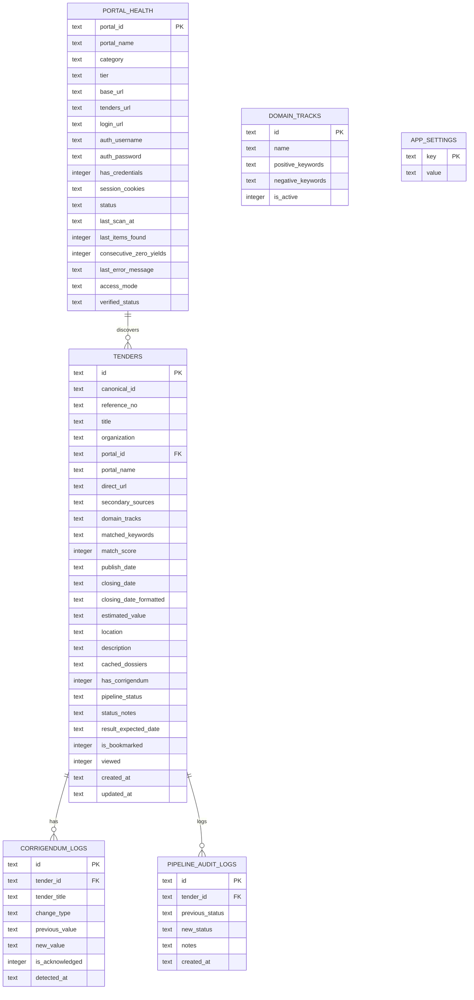

# 03. Database Schema

## Storage Architecture

Tender Tracker uses embedded **SQLite 3** managed via `better-sqlite3`. SQLite was selected for zero-configuration, atomic transactions, blazing read performance, and portable backup capability.

The database file resides at `<DATA_DIR>/tender_tracker.db` alongside its WAL write buffer (`-wal`) and shared memory index (`-shm`).

### Performance Pragmas
Upon connection, `src/server/db.ts` applies:
```sql
PRAGMA journal_mode = WAL;
PRAGMA synchronous = NORMAL;
PRAGMA foreign_keys = ON;
```

---

## Entity-Relationship Diagram



---

## Table Definitions

### 1. `tenders`
The primary entity representing scraped, matched, and tracked procurement opportunities.

| Column | Type | Constraints | Description |
|---|---|---|---|
| `id` | `TEXT` | `PRIMARY KEY` | Unique identifier (e.g., `punjab_eproc-12345` or UUID). |
| `canonical_id` | `TEXT` | `NOT NULL` | Identifies duplicate grouping. Points to the parent tender ID. |
| `reference_no` | `TEXT` | `NULL` | Formal tender reference/tender inquiry number. |
| `title` | `TEXT` | `NOT NULL` | Official tender title / procurement subject. |
| `organization` | `TEXT` | `NOT NULL` | Procuring entity or government department. |
| `portal_id` | `TEXT` | `NOT NULL` | Originating portal identifier. |
| `portal_name` | `TEXT` | `NOT NULL` | Display name of the portal. |
| `direct_url` | `TEXT` | `NOT NULL` | Direct link to the notice on the official website. |
| `secondary_sources` | `TEXT` | `DEFAULT '[]'` | JSON array of `{portalName, directUrl, discoveredAt}`. |
| `domain_tracks` | `TEXT` | `DEFAULT '[]'` | JSON array of matched track names. |
| `matched_keywords` | `TEXT` | `DEFAULT '[]'` | JSON array of matched keyword strings. |
| `match_score` | `INTEGER`| `DEFAULT 0` | Relevance score (0 to 100). |
| `publish_date` | `TEXT` | `NULL` | Notice publication date (ISO string or YYYY-MM-DD). |
| `closing_date` | `TEXT` | `NULL` | Submission deadline (ISO string with PKT offset `+05:00`). |
| `closing_date_formatted`| `TEXT` | `NOT NULL` | Human-friendly display date in PKT format. |
| `estimated_value` | `TEXT` | `NULL` | Estimated tender budget (e.g., `"PKR 45,000,000"`). |
| `location` | `TEXT` | `NULL` | Work/delivery station (e.g., `"Islamabad"`). |
| `description` | `TEXT` | `DEFAULT ''` | Detailed scope or AI First-Look brief extracted from notice. |
| `cached_dossiers` | `TEXT` | `DEFAULT '[]'` | JSON array of downloaded bidding document metadata `{id, filename, filepath, mimeType, sizeBytes, label, downloadedAt}`. |
| `has_corrigendum` | `INTEGER`| `DEFAULT 0` | Flag (0 or 1) indicating active amendment notice. |
| `pipeline_status` | `TEXT` | `DEFAULT 'New Opportunity'` | Status constrained to `TENDER_STATUSES`. |
| `status_notes` | `TEXT` | `DEFAULT ''` | Operator private notes and reminders. |
| `result_expected_date` | `TEXT` | `NULL` | Target date when bid award results are expected (YYYY-MM-DD). |
| `is_bookmarked` | `INTEGER`| `DEFAULT 0` | Starred tender flag (0 or 1). |
| `viewed` | `INTEGER`| `DEFAULT 0` | Read indicator (0 or 1). |
| `created_at` | `TEXT` | `NOT NULL` | Discovery timestamp. |
| `updated_at` | `TEXT` | `NOT NULL` | Last update or rescrape timestamp. |

Indexes:
- `idx_tenders_canonical`: `ON tenders(canonical_id)`
- `idx_tenders_status`: `ON tenders(pipeline_status)`
- `idx_tenders_closing`: `ON tenders(closing_date)`

---

### 2. `corrigendum_logs`
Tracks detected amendments, deadline extensions, and scope changes over time.

| Column | Type | Constraints | Description |
|---|---|---|---|
| `id` | `TEXT` | `PRIMARY KEY` | Unique log identifier. |
| `tender_id` | `TEXT` | `NOT NULL` | Foreign key referencing `tenders(id)`. |
| `tender_title` | `TEXT` | `NULL` | Title snapshot for quick reference. |
| `change_type` | `TEXT` | `NOT NULL` | `'deadline_extension'`, `'scope_revision'`, or `'attachment_update'`. |
| `previous_value` | `TEXT` | `NULL` | Previous deadline date or scope value. |
| `new_value` | `TEXT` | `NOT NULL` | Newly detected value. |
| `is_acknowledged`| `INTEGER`| `DEFAULT 0` | 0 if unread, 1 once cleared by operator. |
| `detected_at` | `TEXT` | `NOT NULL` | Detection timestamp. |

---

### 3. `pipeline_audit_logs`
Provides an immutable audit trail whenever a tender changes status in the pipeline.

| Column | Type | Constraints | Description |
|---|---|---|---|
| `id` | `TEXT` | `PRIMARY KEY` | Unique audit log ID. |
| `tender_id` | `TEXT` | `NOT NULL` | Foreign key referencing `tenders(id)`. |
| `previous_status`| `TEXT` | `NULL` | Status before transition. |
| `new_status` | `TEXT` | `NOT NULL` | New status after transition. |
| `notes` | `TEXT` | `NULL` | Optional operator commentary. |
| `created_at` | `TEXT` | `NOT NULL` | Transition timestamp. |

---

### 4. `domain_tracks`
Configurable business domain filters.

| Column | Type | Constraints | Description |
|---|---|---|---|
| `id` | `TEXT` | `PRIMARY KEY` | Identifier (e.g., `track-solar`). |
| `name` | `TEXT` | `NOT NULL` | Track title (e.g., `"Solar & Clean Energy"`). |
| `positive_keywords`| `TEXT` | `NOT NULL` | JSON array of mandatory match words. |
| `negative_keywords`| `TEXT` | `DEFAULT '[]'` | JSON array of exclusion words. |
| `is_active` | `INTEGER`| `DEFAULT 1` | 1 if actively evaluated during scraping. |

---

### 5. `portal_health`
Maintains operational health, credentials, and scan metrics for each of the 18 portals.

| Column | Type | Constraints | Description |
|---|---|---|---|
| `portal_id` | `TEXT` | `PRIMARY KEY` | Identifier (e.g., `epads`, `punjab_eproc`). |
| `portal_name` | `TEXT` | `NOT NULL` | Human-friendly name. |
| `category` | `TEXT` | `NOT NULL` | `'Regulatory'`, `'Federal/Regional'`, `'Tech & Skills'`, `'Multilateral'`, `'Aggregator'`. |
| `tier` | `TEXT` | `NOT NULL` | `'http'` (Cheerio) or `'playwright'` (Browser). |
| `base_url` | `TEXT` | `NOT NULL` | Primary portal homepage URL. |
| `tenders_url` | `TEXT` | `NOT NULL` | Active tenders page URL. |
| `login_url` | `TEXT` | `NULL` | Login page URL (for portals requiring authentication). |
| `auth_username` | `TEXT` | `NULL` | Operator account username / email. |
| `auth_password` | `TEXT` | `NULL` | Password for portal authentication. |
| `session_cookies`| `TEXT` | `NULL` | Serialized session cookie storage. |
| `status` | `TEXT` | `DEFAULT 'online'` | `'online'`, `'scanning'`, `'hitl_required'`, `'selector_broken'`, `'error'`. |
| `last_scan_at` | `TEXT` | `NULL` | Timestamp of last scan completion. |
| `last_items_found` | `INTEGER`| `DEFAULT 0` | Count of tenders discovered on latest crawl. |
| `consecutive_zero_yields` | `INTEGER`| `DEFAULT 0` | Counter for consecutive runs yielding 0 items. |
| `last_error_message` | `TEXT` | `NULL` | Error details or failure diagnostics. |
| `access_mode` | `TEXT` | `DEFAULT 'public'`| `'public'`, `'login_required'`, `'cloudflare'`, `'offline_broken'`. |
| `verified_status`| `TEXT` | `NULL` | Informational status badge for UI. |

---

### 6. `app_settings`
Key-value storage for application configuration managed directly via the UI (e.g., Google AI Studio Gemini API Key).

| Column | Type | Constraints | Description |
|---|---|---|---|
| `key` | `TEXT` | `PRIMARY KEY` | Setting key (e.g., `'gemini_api_key'`). |
| `value` | `TEXT` | `NULL` | Plaintext value (e.g., API key token). |
