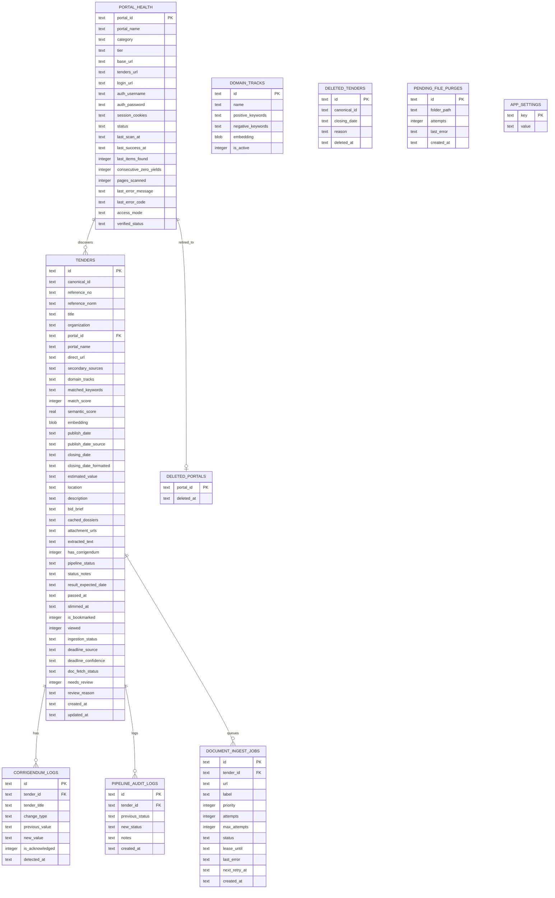

# 03. Database Schema

## Storage Architecture

Tender Tracker uses embedded **SQLite 3** managed via `better-sqlite3`. SQLite was selected for zero-configuration, atomic transactions, blazing read performance, and portable backup capability.

The database file resides at `<DATA_DIR>/tender_tracker.db` alongside its WAL write buffer (`-wal`) and shared memory index (`-shm`).

### Performance Pragmas
Upon connection, `src/server/db/connection.ts` applies:
```sql
PRAGMA journal_mode = WAL;
PRAGMA synchronous = NORMAL;
PRAGMA foreign_keys = ON;
```

### Versioned SQLite Migration Engine (`src/server/db/migrations.ts` & `src/server/db/schema.ts`)
Database initialization runs through `initDatabase(database = db)` in `src/server/db/schema.ts`, powered by the sequential `PRAGMA user_version` migration runner in `src/server/db/migrations.ts`:

- **Core Migration Primitives (`src/server/db/migrations.ts`)**:
  - `getSchemaVersion` / `setSchemaVersion`: Reads and validates SQLite's built-in `PRAGMA user_version` integer.
  - `hasTable` / `hasColumn` / `addColumnIfMissing`: Safe SQLite schema introspection (`sqlite_master` and `PRAGMA table_info`) with strict SQL identifier validation; SQL errors in `addColumnIfMissing` propagate instead of being swallowed so failed migrations roll back cleanly.
  - `runMigrations(database, SCHEMA_MIGRATIONS)`: Validates strictly sequential migration versions (`1..N` with non-empty names and no duplicates) and returns a `MigrationRunResult` (`{ fromVersion, toVersion, applied, skipped }`).
- **Ordered Transactional Migrations (`SCHEMA_MIGRATIONS`, `LATEST_SCHEMA_VERSION = 7`)**:
  Each pending migration executes inside a `database.transaction(...)` alongside `setSchemaVersion(database, version)`. If any DDL/DML step fails, both the schema change and `PRAGMA user_version` roll back atomically:
  1. `v1` (`baseline_core_tables`): Core tables (`tenders`, `corrigendum_logs`, `pipeline_audit_logs`, `domain_tracks`, `portal_health`, `app_settings`, `pending_file_purges`, `deleted_tenders`, `document_ingest_jobs`, `deleted_portals`) and core indexes (`idx_tenders_canonical`, `idx_tenders_status`, `idx_tenders_closing`, `idx_deleted_tenders_canonical`, `idx_ingest_jobs_due`, `idx_ingest_jobs_tender`).
  2. `v2` (`tenders_embeddings_bid_brief_and_portal_error_code`): Adds `result_expected_date`, `embedding`, `semantic_score`, `extracted_text`, `bid_brief` on `tenders`; `embedding` on `domain_tracks`; and `last_error_code` on `portal_health`.
  3. `v3` (`ingestion_provenance_columns_and_backfills`): Adds `ingestion_status`, `deadline_source`, `deadline_confidence`, `doc_fetch_status`, `needs_review`, `review_reason`, `attachment_urls` on `tenders`, creates `idx_tenders_ingestion`, conditionally backfills `deadline_source` / `doc_fetch_status` only when `addColumnIfMissing` actually added the column, and calls `backfillExistingTenderDocumentJobs(database)`.
  4. `v4` (`audit_fix_columns_and_reference_index`): Adds `tenders.reference_norm`, `tenders.publish_date_source`, `deleted_tenders.reason`, `portal_health.last_success_at`, `portal_health.pages_scanned`, and `idx_tenders_reference_norm`.
  5. `v5` (`tenders_fts5_index_and_triggers`): Creates external-content `tenders_fts` virtual table and synchronization triggers (`tenders_fts_ai`, `tenders_fts_ad`, `tenders_fts_au`), running the initial rebuild once under `app_settings` sentinel `migration_tenders_fts_v1_2026_11`.
  6. `v6` (`retire_epads_and_audit_data_cleanup`): Retires the legacy Federal EPADS source in favor of `epms_ppra` (recording the retired ID in `deleted_portals` while preserving historical `tenders` rows, gated by `migration_epms_ppra_2026_11`) and executes one-time data cleanup `runAuditCleanupOnce(database)` (gated by `migration_audit_fixes_2026_11`).
  7. `v7` (`sync_tender_portal_names_and_retire_epads_tenders`): Synchronizes denormalized `tenders.portal_name` labels with current `portal_health.portal_name` values and re-associates remaining legacy Federal EPADS tender rows to `epms_ppra` (`Federal PPRA (EPMS)`).
- **Safety & Startup Guarantees**:
  - **Safe Legacy `user_version = 0` Upgrade Path**: Pre-versioned production databases and legacy backups start with `PRAGMA user_version = 0`. Every `v1`–`v7` migration uses `IF NOT EXISTS`, `addColumnIfMissing`, conditional backfills (never overwriting existing `deadline_source` or `doc_fetch_status` values), and `app_settings` sentinel keys to upgrade cleanly to `LATEST_SCHEMA_VERSION` (`7`).
  - **Forward-Version Guard**: If `PRAGMA user_version > LATEST_SCHEMA_VERSION`, `runMigrations` refuses to start and throws immediately to prevent older application code from corrupting a newer database schema.
  - **Steady-State Fast Path**: When `PRAGMA user_version === LATEST_SCHEMA_VERSION`, `runMigrations` skips all DDL and returns `{ fromVersion: 7, toVersion: 7, applied: [], skipped: true }`.
  - **Always-Run Idempotent Catalog & Portal Syncs**: After migrations complete, `initDatabase()` always executes `seedDefaultDomainTracks(database)` (seeds default tracks only when `domain_tracks` is empty) and `seedPortalHealth(database)` (runs `INSERT OR IGNORE` respecting `deleted_portals`, repairs TLS-legacy `offline_broken` flags, enforces clean `base_url` origins, and upgrades known dead portal domains to `PORTAL_DEFINITIONS` defaults).

---

## Entity-Relationship Diagram



---

## Table Definitions

### 1. `tenders`
The primary entity representing scraped, matched, and tracked procurement opportunities.

| Column | Type | Constraints | Description |
|---|---|---|---|
| `id` | `TEXT` | `PRIMARY KEY` | Unique identifier (e.g., `punjab_eproc-12345` or UUID). |
| `canonical_id` | `TEXT` | `NOT NULL` | Identifies duplicate grouping. Points to the parent tender ID. |
| `reference_no` | `TEXT` | `NULL` | Formal tender reference/tender inquiry number. |
| `reference_norm` | `TEXT` | `NULL` | Canonical normalized alphanumeric reference (uppercase, stripped dates/prefixes) for strict Tier-1 deduplication. |
| `title` | `TEXT` | `NOT NULL` | Official tender title / procurement subject. |
| `organization` | `TEXT` | `NOT NULL` | Procuring entity or government department. |
| `portal_id` | `TEXT` | `NOT NULL` | Originating portal identifier. |
| `portal_name` | `TEXT` | `NOT NULL` | Display name of the portal. |
| `direct_url` | `TEXT` | `NOT NULL` | Direct link to the notice on the official website. |
| `secondary_sources` | `TEXT` | `DEFAULT '[]'` | JSON array of `{portalName, directUrl, discoveredAt}`. Excludes tender's own portal. |
| `domain_tracks` | `TEXT` | `DEFAULT '[]'` | JSON array of matched track names. |
| `matched_keywords` | `TEXT` | `DEFAULT '[]'` | JSON array of matched keyword strings. |
| `match_score` | `INTEGER`| `DEFAULT 0` | Relevance score (0 to 100). |
| `publish_date` | `TEXT` | `NULL` | Notice publication date (ISO string or YYYY-MM-DD). |
| `publish_date_source` | `TEXT` | `NULL` | Provenance of publish date: `html_row`, `html_detail`, `document`, or `upload_folder` (upload-folder dates are excluded from 90-day ageing calculations). |
| `closing_date` | `TEXT` | `NULL` | Submission deadline (ISO string with PKT offset `+05:00`). |
| `closing_date_formatted`| `TEXT` | `NOT NULL` | Human-friendly display date in PKT format. |
| `estimated_value` | `TEXT` | `NULL` | Estimated tender budget (e.g., `"PKR 45,000,000"`). |
| `location` | `TEXT` | `NULL` | Work/delivery station (e.g., `"Islamabad"`). |
| `description` | `TEXT` | `DEFAULT ''` | Detailed scope or AI First-Look brief extracted from notice. |
| `bid_brief` | `TEXT` | `NULL` | Optional JSON `BidBrief` (`bidSecurityAmount`, `tenderFee`, `requiredRegistrations`, `requiredExperience`, `deliverablesSummary`, `bidMethod`). |
| `cached_dossiers` | `TEXT` | `DEFAULT '[]'` | JSON array of downloaded bidding document metadata `{label, localPath, originalUrl, mimeType, sha256, sizeBytes, downloadedAt}`. |
| `attachment_urls` | `TEXT` | `DEFAULT '[]'` | JSON array of discovered document URLs persisted at ingest so attachments can be backfilled or re-queued (`P1-1`). |
| `extracted_text` | `TEXT` | `DEFAULT ''` | Aggregated local PDF/DOCX and OCR document text synchronized into `tenders_fts`. |
| `embedding` | `BLOB` | `NULL` | Tagged 384-dimensional float32 vector (`model`-tagged `all-MiniLM-L6-v2` or `fast`-tagged fallback). |
| `semantic_score` | `REAL` | `DEFAULT 0` | Cosine similarity score against the best-matching active domain track. |
| `has_corrigendum` | `INTEGER`| `DEFAULT 0` | Flag (0 or 1) indicating active amendment notice. |
| `pipeline_status` | `TEXT` | `DEFAULT 'New Opportunity'` | Status constrained to `TENDER_STATUSES`. |
| `status_notes` | `TEXT` | `DEFAULT ''` | Operator private notes and reminders. |
| `result_expected_date` | `TEXT` | `NULL` | Target date when bid award results are expected (YYYY-MM-DD). |
| `passed_at` | `TEXT` | `NULL` | Timestamp when the tender was marked `Passed` (drives 2-minute delayed dossier slimming). |
| `slimmed_at` | `TEXT` | `NULL` | Timestamp when cached dossier files for a `Passed` tender were purged from disk. |
| `is_bookmarked` | `INTEGER`| `DEFAULT 0` | Starred tender flag (0 or 1). |
| `viewed` | `INTEGER`| `DEFAULT 0` | Read indicator (0 or 1). |
| `created_at` | `TEXT` | `NOT NULL` | Discovery timestamp. Also the ageing fallback for undated tenders with no `publish_date`. |
| `updated_at` | `TEXT` | `NOT NULL` | Last update or rescrape timestamp. |
| `ingestion_status` | `TEXT` | `DEFAULT 'ready'` | `staging` (mid-ingest; hidden from listings, KPIs and retention), `awaiting_scope` (held generic/unmatched listing awaiting document reading), `ready`, or `failed_verification`. Staging rows older than 60 minutes are released to `ready` by retention; `awaiting_scope` rows older than 3 days are purged. |
| `deadline_source` | `TEXT` | `NULL` | Where `closing_date` came from: `corrigendum_doc`, `primary_doc`, `html_detail`, `html_row`, `manual`. |
| `deadline_confidence` | `TEXT` | `NULL` | `high`, `medium` or `low`. |
| `doc_fetch_status` | `TEXT` | `DEFAULT 'none'` | Derived from `document_ingest_jobs`: `none`, `pending`, `partial`, `complete`, `failed`. |
| `needs_review` | `INTEGER` | `DEFAULT 0` | `1` when the operator must confirm something, e.g. a corrigendum or re-scan moved the deadline earlier, or a notice was cancelled. |
| `review_reason` | `TEXT` | `NULL` | Machine/human-readable reason (`deadline_moved_earlier: ...`, `corrigendum_cancelled`, `uncertain_past_deadline: ...`, `excluded_terms_in_documents: ...`). |

### `document_ingest_jobs`
Durable retry queue for tender document downloads and extraction. Rows are deleted with their tender (`ON DELETE CASCADE`). All access goes through `src/server/db/repositories/ingestJobsRepo.ts`.

| Column | Type | Notes |
|---|---|---|
| `id` | `TEXT PRIMARY KEY` | `job-<uuid>` |
| `tender_id` | `TEXT NOT NULL` | `REFERENCES tenders(id) ON DELETE CASCADE` |
| `url` | `TEXT NOT NULL` | `UNIQUE (tender_id, url)`, so queueing the same file twice is a no-op |
| `label` | `TEXT` | Display label |
| `priority` | `INTEGER DEFAULT 50` | Lower runs first: corrigendum 10, RFP/notice 20, other 50 |
| `attempts` / `max_attempts` | `INTEGER` | Attempt counted when a job is claimed; default max 3 |
| `status` | `TEXT DEFAULT 'pending'` | `pending`, `processing`, `done`, `failed` |
| `lease_until` | `TEXT` | Expired leases return to `pending` (or `failed` if out of attempts) |
| `last_error` | `TEXT` | Last failure message |
| `next_retry_at` | `TEXT` | Backoff 2 → 10 → 30 minutes after each failed attempt |
| `created_at` | `TEXT` | |

Indexes:
- `idx_tenders_canonical`: `ON tenders(canonical_id)`
- `idx_tenders_status`: `ON tenders(pipeline_status)`
- `idx_tenders_closing`: `ON tenders(closing_date)`

---

### 2. `corrigendum_logs`
Tracks detected amendments, deadline extensions, and scope changes over time.

| Column | Type | Constraints | Description |
|---|---|---|---|
| `id` | `TEXT` | `PRIMARY KEY` | Unique log identifier. |
| `tender_id` | `TEXT` | `NOT NULL` | Foreign key referencing `tenders(id)`. |
| `tender_title` | `TEXT` | `NULL` | Title snapshot for quick reference. |
| `change_type` | `TEXT` | `NOT NULL` | `'deadline_extension'`, `'scope_revision'`, or `'attachment_update'`. |
| `previous_value` | `TEXT` | `NULL` | Previous deadline date or scope value. |
| `new_value` | `TEXT` | `NOT NULL` | Newly detected value. |
| `is_acknowledged`| `INTEGER`| `DEFAULT 0` | 0 if unread, 1 once cleared by operator. |
| `detected_at` | `TEXT` | `NOT NULL` | Detection timestamp. |

---

### 3. `pipeline_audit_logs`
Provides an immutable audit trail whenever a tender changes status in the pipeline.

| Column | Type | Constraints | Description |
|---|---|---|---|
| `id` | `TEXT` | `PRIMARY KEY` | Unique audit log ID. |
| `tender_id` | `TEXT` | `NOT NULL` | Foreign key referencing `tenders(id)`. |
| `previous_status`| `TEXT` | `NULL` | Status before transition. |
| `new_status` | `TEXT` | `NOT NULL` | New status after transition. |
| `notes` | `TEXT` | `NULL` | Optional operator commentary. |
| `created_at` | `TEXT` | `NOT NULL` | Transition timestamp. |

---

### 4. `domain_tracks`
Configurable business domain filters.

| Column | Type | Constraints | Description |
|---|---|---|---|
| `id` | `TEXT` | `PRIMARY KEY` | Identifier (e.g., `track-solar`). |
| `name` | `TEXT` | `NOT NULL` | Track title (e.g., `"Solar & Clean Energy"`). |
| `positive_keywords`| `TEXT` | `NOT NULL` | JSON array of mandatory match words. |
| `negative_keywords`| `TEXT` | `DEFAULT '[]'` | JSON array of exclusion words. |
| `embedding` | `BLOB` | `NULL` | Cached 384-D `all-MiniLM-L6-v2` embedding of track name + positive keywords. |
| `is_active` | `INTEGER`| `DEFAULT 1` | 1 if actively evaluated during scraping. |

---

### 5. `portal_health`
Maintains operational health, credentials, and scan metrics for each of the 19 portals.

| Column | Type | Constraints | Description |
|---|---|---|---|
| `portal_id` | `TEXT` | `PRIMARY KEY` | Identifier (e.g., `epms_ppra`, `punjab_eproc`). |
| `portal_name` | `TEXT` | `NOT NULL` | Human-friendly name. |
| `category` | `TEXT` | `NOT NULL` | `'Regulatory'`, `'Federal/Regional'`, `'Tech & Skills'`, `'Multilateral'`, `'Aggregator'`. |
| `tier` | `TEXT` | `NOT NULL` | `'http'` (Cheerio) or `'playwright'` (Browser). |
| `base_url` | `TEXT` | `NOT NULL` | Primary portal homepage URL. |
| `tenders_url` | `TEXT` | `NOT NULL` | Active tenders page URL. |
| `login_url` | `TEXT` | `NULL` | Login page URL (for portals requiring authentication). |
| `auth_username` | `TEXT` | `NULL` | Operator account username / email. |
| `auth_password` | `TEXT` | `NULL` | Password for portal authentication. |
| `session_cookies`| `TEXT` | `NULL` | Serialized session cookie storage. |
| `status` | `TEXT` | `DEFAULT 'online'` | `'online'`, `'scanning'`, `'hitl_required'`, `'selector_broken'`, `'error'`. |
| `last_scan_at` | `TEXT` | `NULL` | Timestamp of last scan completion. |
| `last_success_at` | `TEXT` | `NULL` | Timestamp of the last scan of this portal that finished without a connection error, verification challenge or login wall, whatever the number of items (`HLT-5` in `docs/13`). |
| `last_items_found` | `INTEGER`| `DEFAULT 0` | Count of tenders discovered on latest crawl. |
| `pages_scanned` | `INTEGER`| `DEFAULT 1` | Number of pagination pages crawled during latest run. |
| `consecutive_zero_yields` | `INTEGER`| `DEFAULT 0` | Counter for consecutive runs yielding 0 items. |
| `last_error_message` | `TEXT` | `NULL` | Error details or failure diagnostics. |
| `last_error_code` | `TEXT` | `NULL` | Structured `ScraperErrorCode` (`TIMEOUT`, `TLS_ERROR`, `CLOUDFLARE_HITL`, `LOGIN_REQUIRED`, `HTTP_4XX_5XX`, `PARSE_EMPTY`, `NETWORK_UNREACHABLE`). |
| `access_mode` | `TEXT` | `DEFAULT 'public'`| `'public'`, `'login_required'`, `'cloudflare'`, `'offline_broken'`. |
| `verified_status`| `TEXT` | `NULL` | Informational status badge for UI. |

---

### 6. `app_settings`
Key-value storage for application configuration managed directly via the UI:
- `gemini_api_key`: Google AI Studio API key.
- `local_ocr_enabled` (`true`/`false`, default `true`): Enables/disables offline `tesseract.js` fallback (`DOC-11`).
- `retention_auto_clean` (`true`/`false`), `retention_grace_days` (default `2`), `retention_passed_days` (default `10`).
- `ingest_upfront_time_budget_sec` (default `300`), `ingest_max_file_mb` (default `25`), `ingest_vision_calls_per_scan` (default `20`), `ingest_vision_calls_per_day` (default `100`).
- `ingest_ai_text_calls_per_day` (default `150`): Daily budget cap for Gemini text cross-checks (`C3`).
- `ingest_vision_calls_YYYY-MM-DD`: Daily background Vision counter (counters older than 7 days are automatically pruned by `pruneOldDailyVisionCounters(7)` during the retention cycle).
- `digest_enabled` (`true`/`false`), `digest_webhook_url` (SSRF-validated via `urlSafety.ts`), `digest_within_hours` (default `48`), `digest_last_sent_pkt` (`YYYY-MM-DD`): Daily closing alert digest settings (`OPS-7`, `SEC-5`).
- `last_full_scan_at`: Timestamp when the last full multi-portal scan completed (`F5`).
- `last_deep_scan_at`: Timestamp when the last `deep` pagination crawl completed (`scheduler.ts`).

| Column | Type | Constraints | Description |
|---|---|---|---|
| `key` | `TEXT` | `PRIMARY KEY` | Setting key (e.g., `'gemini_api_key'`). |
| `value` | `TEXT` | `NULL` | Plaintext value. |

---

### 7. `deleted_portals`, `deleted_tenders` & `pending_file_purges`
- **`deleted_portals`**: Tombstone registry (`portal_id TEXT PRIMARY KEY`, `deleted_at TEXT DEFAULT CURRENT_TIMESTAMP`) preserving operator-deleted or retired portals (`HLT-7`) across restarts.
- **`deleted_tenders`**: Suppression registry (`id`, `canonical_id`, `closing_date`, `deleted_at`, `reason`) preventing deleted, passed-and-retired, or auto-expired notices from being re-downloaded and re-inserted on subsequent crawls:
  - `reason`: Provenance of deletion (`'user'`, `'auto-expired'`, `'no-track-match'`, `'legacy'`).
  - Suppression expiry & unblocking: Undated suppressions expire after 120 days. Auto-expired suppressions are automatically lifted if a re-scan finds a new future closing date (`F4`). User-initiated deletions are never unblocked.
- **`pending_file_purges`**: Retry queue (`id`, `folder_path`, `attempts`, `last_error`, `created_at`) for dossier folders locked by Windows file handles at deletion time (`dossierStore.ts`).

---

### 8. `tenders_fts` (SQLite FTS5 Virtual Table)
External-content full-text search index (`content='tenders'`, `content_rowid='rowid'`, `tokenize='unicode61 remove_diacritics 2'`) indexing `title`, `organization`, `reference_no`, `portal_name`, `description`, and `extracted_text` (text extracted from downloaded digital PDFs, DOCX files, and OCR summaries).
- Maintained automatically on all inserts, deletes, and updates via SQLite triggers (`tenders_fts_ai`, `tenders_fts_ad`, `tenders_fts_au`).
- Queried safely through `buildFts5PrefixQuery` in `src/server/db/repositories/tendersRepo.ts`, with substring and MiniLM semantic similarity fallbacks so punctuation-heavy queries (`C++`, `2026-27`) never fail.
