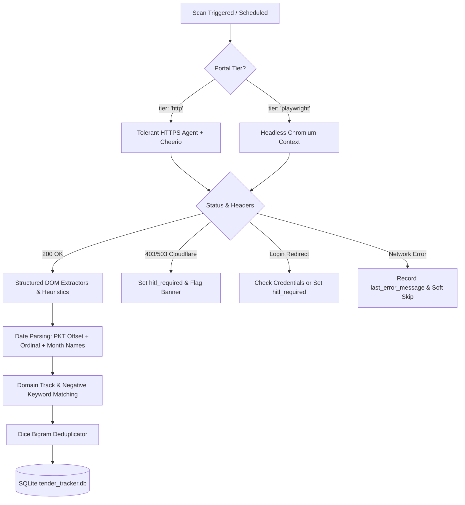

# 05. Portals Catalog & Scraping Architecture

## The 18 Pakistan Procurement Portals

Tender Tracker catalogs 18 official and aggregator procurement portals across Pakistan, categorized into 5 operational sectors:

| ID | Portal Name | Category | Tier | Access Mode | Scraping Strategy & Operational Status |
|---|---|---|---|---|---|
| `epads` | Federal PPRA (EPMS / EPADS) | Regulatory | `playwright` | `login_required` | Statutory federal electronic procurement portal. Main notice board is public; bidding document downloads require operator login credentials. |
| `punjab_eproc` | Punjab PPRA | Regulatory | `http` | `public` | Highest volume provincial source (865+ active tenders). Scraped via Cheerio with toleration for ASP.NET postback tables. |
| `sppra` | Sindh SPPRA | Regulatory | `playwright` | `public` | Dynamic Angular/Vue portal indexing 12,000+ listings. Headless Playwright context renders DOM before extraction. |
| `kppra` | Khyber Pakhtunkhwa KPPRA | Regulatory | `playwright` | `offline_broken` | KP EPADS portal currently protected by basic-auth challenge; health probe tracks connectivity without interrupting crawls. |
| `bppra` | Balochistan BPPRA | Regulatory | `http` | `offline_broken` | Provincial notice board frequently renders blank; monitored via non-blocking HTTP probes. |
| `ndma` | National Disaster Management Authority (NDMA) | Federal/Regional | `http` | `public` | Emergency procurement and disaster relief infrastructure (scraped via `.tender-card` DOM extractors). |
| `fde` | Federal Directorate of Education (FDE) | Federal/Regional | `http` | `public` | Islamabad school solarization, furniture, and educational supplies (scraped via `h3.package-title`). |
| `mofept` | Ministry of Federal Education & Professional Training | Federal/Regional | `http` | `public` | Federal education ministry active tenders with server-side search parsing. |
| `gilgit` | Government of Gilgit-Baltistan | Federal/Regional | `http` | `offline_broken` | Regional portal lacks dedicated tenders directory; handled gracefully by crawler. |
| `pseb` | Pakistan Software Export Board (TechDestination) | Tech & Skills | `http` | `public` | Rebranded to TechDestination; extracts tender notices and attached bidding PDFs. |
| `ignite` | Ignite National Technology Fund | Tech & Skills | `http` | `public` | National innovation and startup incubators procurement tab. |
| `psdf` | Punjab Skills Development Fund (PSDF) | Tech & Skills | `http` | `public` | Apex TVET and skills training procurement listings (scraped via `.inner-advertisement-listing-box`). |
| `psda` | Punjab Skills Development Authority (PSDA) | Tech & Skills | `http` | `public` | Regulatory vocational authority tender board. |
| `peef` | Punjab Educational Endowment Fund (PEEF) | Tech & Skills | `http` | `public` | Educational supplies and IT consumables handled via tolerant SSL HTTPS agent. |
| `ungm` | United Nations Global Marketplace (UNGM) | Multilateral | `playwright` | `public` | UN agencies procurement for Pakistan operations (1,700+ live global notices). |
| `giz` | Deutsche Gesellschaft für Internationale Zusammenarbeit (GIZ) | Multilateral | `http` | `public` | German international development cooperation country tenders. |
| `tender_services` | Tender Services Pakistan | Aggregator | `playwright` | `login_required` | Commercial aggregator consolidating nationwide notices. Automated login at `https://tenderservice.pk/permits/login.php` with cookie capture. |
| `pid` | Press Information Department / Gazettes (PID) | Aggregator | `http` | `public` | Federal government statutory gazette advertisements and tender releases. |

---

## Two-Tier Scraping Architecture

### Tier 1: Tolerant HTTP + Cheerio (`tier: 'http'`)
Static HTML pages are fetched using Node's `https` module equipped with a tolerant SSL agent:
- **Tolerant SSL Agent**: Configured with `rejectUnauthorized: false` to navigate Pakistani municipal subdomains that use intermediate chain-broken or expired SSL certificates.
- **Human Masquerade**: Requests provide realistic Chrome headers (`User-Agent`, `sec-ch-ua`, `Accept-Language: en-US,en;q=0.9,ur;q=0.8`).
- **Domain False-Positive Filtering**: Excludes default portal names from positive keyword matching so education/skills boards do not falsely match 100% of notices.

### Tier 2: Dynamic Browser Execution (`tier: 'playwright'`)
Portals employing client-side Single Page Application (SPA) architectures (such as Sindh SPPRA or UNGM) or requiring authenticated cookie contexts:
- **Chromium Session**: Spawns isolated browser contexts with pre-loaded cookies from `data/sessions/`.
- **Graceful Fallback**: If browser binaries fail to launch, the engine falls back to the HTTP Cheerio scraper with an error log rather than crashing the scan.

---

## Friction Resolution & Human-in-the-Loop (HITL)

When a portal deploys Cloudflare Turnstile, CAPTCHA bot protection, or requires manual multi-factor verification:
1. **Challenge Detection**:
   The crawler inspects HTTP response codes (403/503) and HTML content for Cloudflare markers (`cf-browser-verification`, `Turnstile`, `cf-chl-bypass`). Small challenge pages trigger `hitl_required`, while standard WordPress footer widgets are ignored.
2. **Flagging**:
   The portal's status in `portal_health` is set to `hitl_required`, and an amber alert banner appears in the application's top KPI bar.
3. **One-Click Resolution**:
   The operator clicks **"Launch HITL Browser"** from the UI. A visible (headed) Chromium window opens to the target URL. The operator solves the CAPTCHA or logs in.
4. **Cookie Harvesting**:
   Upon clicking **"I've finished"** or verifying through the credentials modal, session cookies are serialized to `data/sessions/<portalId>/cookies.txt` and the portal returns to `online`.
