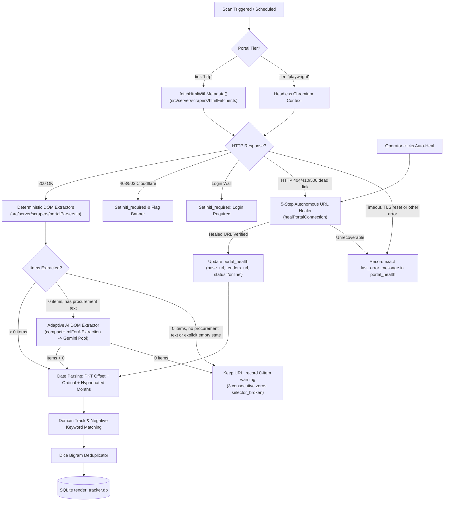

# 05. Portals Catalog & Self-Healing Scraping Architecture

## The 19 Pakistan Procurement Portals

Tender Tracker catalogs 19 official and aggregator procurement portals across Pakistan, categorized into 5 operational sectors.

These 19 are the canonical definitions in `PORTAL_DEFINITIONS` (`src/server/scrapers/portalList.ts`). A given installation can track fewer: a portal the operator removes from **Sources > Portals** is recorded in the `deleted_portals` table and is not re-seeded on restart. The live database tracks 14 active online portals (completing the full 7-board statutory backbone: `epms_ppra`, `punjab_eproc`, `sppra`, `kppra`, `bppra`, `gilgit`, and `ajk_ppra`, with `deleted_portals` recording `epads`, `giz`, `pid`, `tender_services`, `ungm`, and `psda`).

| ID | Portal Name | Category | Tier | Access Mode | Default Tenders URL | Scraping Strategy & Operational Status |
|---|---|---|---|---|---|---|
| `epms_ppra` | Federal PPRA (EPMS) | Regulatory | `http` | `public` | `https://epms.ppra.gov.pk/public/tenders/active-tenders?status=1` | Federal public SSR Bootstrap tender board (`?status=1` Published filter, 50/page, `quickMaxPages: 4` / `deepMaxPages: 20`, cancelled-reason & status-column corrigendum handling, `&#38;` decoding, deterministic BidBrief & folder-aware `/pdf?file=` document labels). |
| `punjab_eproc` | Punjab PPRA | Regulatory | `http` | `public` | `https://eproc.punjab.gov.pk/ActiveTenders.aspx` | Highest volume provincial source (750+ active tenders). Scraped via Cheerio RadGrid extractor (`table.rgMasterTable`) with ASP.NET `__doPostBack` pagination, `legacyTlsHosts` caching + `Origin`/`Referer` POST headers in `src/server/scrapers/htmlFetcher.ts`, `Addendum`/`Corrigendum` flagging, `Sales/Auction/Disposal` row skipping, Punjab city/district `location` extraction (`extractPunjabLocation`), and generic title disambiguation. |
| `sppra` | Sindh SPPRA | Regulatory | `http` | `public` | `https://portalsindh.eprocure.gov.pk/#/` | Official Sindh EPADS public portal (13,500+ active listings) fetched directly via `sppraApi.ts` (`apiprd.eprocure.gov.pk` JSON API + DMS base64 PDF downloads for NIT & PA Published Documents), with Angular `<section class="card">` DOM fallback in `portalParsers.ts`. |
| `kppra` | Khyber Pakhtunkhwa KPPRA | Regulatory | `http` | `public` | `https://kp.gov.pk/tenders` | Official KP Government & KPPRA public tenders REST API (`mgn1.kp.gov.pk/api/tenders`) via `kpApi.ts` (`quickMaxPages: 8` / `deepMaxPages: 15`), mapping `uuid` detail URLs, `media`/`bidding_document`/`corrigenda` PDFs with deadline auto-extension, auction skipping, and KP district `location` extraction (`extractKpLocation`). |
| `bppra` | Balochistan BPPRA | Regulatory | `playwright` | `public` | `https://bpptwo.vdc.services:5451/Tenders` | Balochistan ePPS Blazor portal (`bppraScraper.ts`: `Active Tenders` 100/page pagination + `/RFP`, `/PreQualification`, and `/EOI` tabs, District location & Corrigendum extraction in `portalParsers.ts`, plus deterministic `:9446` NIT JSON API `BidBrief` / FTS5 text & automatic BOQ PDF discovery in `tenderAnalysis.ts`). |
| `ajk_ppra` | AJK PPRA (`ajkppra.gov.pk`) | Regulatory | `http` | `public` | `https://www.ajkppra.gov.pk/advertisements.php` | Azad Jammu & Kashmir statutory procurement board scraped via Section 3g `table.table` parser in `portalParsers.ts`, skipping `Sales/Auction/Disposal` rows, parsing `DD-MM-YYYY` dates, extracting main + inline red `Corrigendum` PDFs (`isCorrigendum`), inferring AJK district `location` (`extractAjkLocation`), and sending portal `Referer` headers in `dossierManager.ts`. |
| `ndma` | National Disaster Management Authority (NDMA) | Federal/Regional | `http` | `public` | `https://ndma.gov.pk/tenders` | Emergency procurement and disaster relief infrastructure (scraped via `.tender-card` DOM extractors). |
| `fde` | Federal Directorate of Education (FDE) | Federal/Regional | `http` | `public` | `https://fde.gov.pk/download-category/tender/` | Islamabad school solarization, furniture, and educational supplies (scraped via `h3.package-title`). |
| `mofept` | Ministry of Federal Education & Professional Training | Federal/Regional | `http` | `public` | `https://mofept.gov.pk/Tenders` | Federal education ministry active tenders with server-side search parsing. |
| `gilgit` | Gilgit-Baltistan PPRA (`gbppra.gov.pk`) | Regulatory | `http` | `public` | `https://gbppra.gov.pk/viewall` | Gilgit-Baltistan PPRA procurement board (`quickMaxPages: 4` / `deepMaxPages: 12`), scraped via Section 3c `.job-post-item` parser in `portalParsers.ts` skipping non-biddable `.badge-wrap .badge` statuses (evaluation reports, results, cancelled, postponed, auction, work/supply orders), flagging `Corrigendum`/`Addendum`, reading `.text-success` / `.text-danger` dates, and extracting GB district `location` (`extractGbLocation`). |
| `pseb` | Pakistan Software Export Board (TechDestination) | Tech & Skills | `http` | `public` | `https://techdestination.com/tenders/` | Rebranded to TechDestination; extracts tender notices and attached bidding PDFs. |
| `ignite` | Ignite National Technology Fund | Tech & Skills | `http` | `public` | `https://ignite.org.pk/procurement/` | National innovation and startup incubators procurement tab. |
| `psdf` | Punjab Skills Development Fund (PSDF) | Tech & Skills | `http` | `public` | `https://psdf.org.pk/procurement` | Apex TVET and skills training procurement listings (scraped via `.inner-advertisement-listing-box`). |
| `psda` | Punjab Skills Development Authority (PSDA) | Tech & Skills | `http` | `public` | `https://psda.punjab.gov.pk/tenders` | Regulatory vocational authority tender board. |
| `peef` | Punjab Educational Endowment Fund (PEEF) | Tech & Skills | `http` | `public` | `https://peef.org.pk/tenders` | Educational supplies and IT consumables handled via tolerant SSL HTTPS agent. |
| `ungm` | United Nations Global Marketplace (UNGM) | Multilateral | `playwright` | `public` | `https://www.ungm.org/Public/Notice` | UN agencies procurement for Pakistan operations (1,700+ live global notices). |
| `giz` | Deutsche Gesellschaft für Internationale Zusammenarbeit (GIZ) | Multilateral | `http` | `public` | `https://www.giz.de/en/workingwithgiz/bidding_procurement.html` | German international development cooperation country tenders. |
| `tender_services` | Tender Services Pakistan | Aggregator | `playwright` | `login_required` | `https://tenderservice.pk` | Commercial aggregator consolidating nationwide notices. Automated login at `https://tenderservice.pk/permits/login.php` with cookie capture. |
| `pid` | Press Information Department / Gazettes (PID) | Aggregator | `http` | `public` | `https://pid.gov.pk` | Federal government statutory gazette advertisements and tender releases. |

---

## Self-Healing Scraping Pipeline



### 1. Deterministic Multi-Pattern DOM Extractors (`parsePortalHtml` in `src/server/scrapers/portalParsers.ts`)
Before invoking any AI model, `parsePortalHtml()` executes fast Cheerio-based structural extractors tailored to Pakistani procurement portals:
- **NDMA Cards (`.tender-card`)**: Extracts `.tender-card__title`, `[data-label*="Submission"]`, `[data-label*="Opening"]`, and attached PDFs.
- **WordPress Download Manager (`h3.package-title`)**: Used by FDE; strips leading date prefixes from package titles and extracts card metadata.
- **PSDF Listing Boxes (`.inner-advertisement-listing-box`)**: Extracts `h4/.listingadver-title1` and notice image attachments.
- **BPPRA ePPS Multi-Row Tables (`tr.tender-row-main` + sibling `tr.tender-row-dates`)**: Groups `rowspan="3"` rows together so the `TSE-...` reference number, title, procuring agency, budget, document links (`Bidding Document`, `NIT Document`, `BOQ Document`), and sibling `Publish:` / `Dead Line:` dates are combined into a single clean tender record.
- **Standard Tables & Elementor PDF Directories**: Parses Drupal views, ASP.NET GridViews, and direct PDF procurement links while filtering out generic button labels (`Download`, `Click to view`, `Bidding Document`, `NIT Document`, `BOQ Document`).

### 2. Adaptive AI HTML Layout Extraction (Phase 2 Zero-Yield Recovery in `src/server/scrapers/crawlerEngine.ts`)
When a portal redesigns its HTML template (e.g., switches from `<table>` to custom `<div>` grids or Blazor/React components) such that `parsePortalHtml()` returns `0` items on an HTTP 200 page:
1. **Signal Verification (`hasProcurementSignals`)**: Confirms the page contains genuine procurement vocabulary (`tender`, `procurement`, `rfp`, `bid`, `nit`, `deadline`) and is not an explicit empty state (`"No active tenders"`).
2. **Link-Preserving DOM Compaction (`compactHtmlForAiExtraction`)**: Strips `<script>`, `<style>`, `<svg>`, `<nav>`, `<footer>`, and `<header>`, converts `<a href="...">Label</a>` into inline `[Label](resolvedUrl)` markdown so download and detail links are retained, and compacts whitespace to $\le 25,000$ characters.
3. **Structured Gemini Extraction (`extractTenderListFromHtmlWithAI`)**: Sends the compacted digest to the 4-model Gemini failover chain (`gemini-flash-lite-latest` $\rightarrow$ `gemini-3.1-flash-lite` $\rightarrow$ `gemini-3.5-flash` $\rightarrow$ `gemini-3.8-flash`) and validates each returned tender item.

### 3. Five-Step Autonomous URL Discovery & The 7 Anti-Corruption Rules (`src/server/scrapers/healer.ts`)
When a configured `tenders_url` fails with a dead-link HTTP error (`404`, `410`, or `500`) or the operator manually clicks **Auto-Heal** in the UI, `healPortalConnection()` executes the 5-step discovery workflow under the **7 Self-Healing Anti-Corruption Rules** (`AGENTS.md §2`):
1. **Rule 1 — Strict Trigger Gating**: Never trigger Auto-Heal on HTTP 200 0-item scans, TLS resets, or network timeouts. Only trigger on HTTP 404/410/500 or manual operator request.
2. **Rule 2 — Non-Destructive Redirects**: Only update in-memory URLs if verified with genuine tender yield.
3. **Rule 3 — Registrable Domain Boundary**: Candidate links must share the portal hostname or official parent domain.
4. **Rule 4 — Anti-Downgrade Path Guard**: Never replace a specific listing path (e.g., `/ActiveTenders.aspx`) with a bare root `/` or a static `.pdf`/`.docx` file.
5. **Rule 5 — Quality-Verified Yield Proof**: Require $\ge 2$ extracted items, or $1$ item with a closing date plus reference number or attachment. Never accept empty table states (`hasEmptyTenderTableState`, including `"No active tenders"` and PSDA `"No Opening"`).
6. **Rule 6 — Strict `base_url` Normalization**: Store only clean URL origins (`https://host:port`) in `base_url`.
7. **Rule 7 — Canonical Baseline Immutability**: Always retain canonical defaults in `PORTAL_DEFINITIONS` so `POST /api/portals/:portalId/reset-default` can restore any portal at any time.

---

## Portal Contract Test Suite (`tests/scraper/portal-contracts.test.ts`)

Every portal in `PORTAL_DEFINITIONS` is accounted for in `tests/scraper/portal-contracts.test.ts`:
- **Captured Live Fixtures (`<= 50 KB` each)**: `epms_ppra`, `bppra`, `ndma`, `fde` (plus `fde_detail` exercising WordPress Download Manager `?wpdmdl=` attachment discovery), `mofept`, `pseb`, `ignite`, `psdf`, and `peef`.
- **Synthetic Fixtures**: `punjab_eproc`, `sppra`, `gilgit`, `ajk_ppra`, `tender_services`, `cloudflare_challenge`, and `login_required`.
- **Documented HTTP Zero-Yield / Non-Listing Portals**:
  - `psda`: Live page renders `<p><span><b>No Opening</b></span></p>` (recognized by `hasEmptyTenderTableState`).
  - `giz`: Overview page linking to external procurement portals (`ausschreibungen.giz.de`, `service.bund.de`, `ted.europa.eu`).
  - `pid`: Press Information Department homepage containing press releases rather than structured tender rows.
- **Explicitly Excluded (`NOT_COVERED`)**: `kppra` (JSON API-backed via `kpApi.ts`, covered in `tests/scraper/kp-api.test.ts`), and `ungm` (requires Playwright JS rendering).

---

## Friction Resolution & Human-in-the-Loop (HITL)

When a portal deploys Cloudflare Turnstile, CAPTCHA bot protection, or requires manual multi-factor verification:
1. **Challenge Detection**:
   The crawler inspects HTTP response codes (403/503) and HTML content for Cloudflare markers (`cf-browser-verification`, `Turnstile`, `challenges.cloudflare.com`).
2. **Flagging & Explicit Failure Reason**:
   The portal's status in `portal_health` is set to `hitl_required`, and the exact reason (`Verification challenge detected` or `Login credentials or active session required`) is displayed in the **Sources > Portals** list.
3. **One-Click Resolution**:
   The operator clicks **"Launch HITL Browser"** from the UI. A visible Chromium window opens to the target URL. Once solved, harvested cookies are saved to `data/sessions/<portalId>/cookies.txt` and the portal returns to `online`.

---

## Portal Configuration & Pagination Schema (`src/server/scrapers/portalList.ts`)

Every canonical portal in `PORTAL_DEFINITIONS` conforms to `PortalDefinition` and optional two-speed `PaginationConfig`:

```typescript
export interface PaginationConfig {
  kind: 'query' | 'path' | 'postback' | 'click';
  param?: string;          // e.g. 'page'
  pathPattern?: string;
  maxPages: number;        // baseline crawl page bound
  quickMaxPages?: number;  // fast periodic crawl bound (with DB early-stop on known pages)
  deepMaxPages?: number;   // 24h deep crawl bound
  nextSelector?: string;
}

export interface PortalDefinition {
  id: string;
  name: string;
  category: 'Regulatory' | 'Federal/Regional' | 'Tech & Skills' | 'Multilateral' | 'Aggregator';
  tier: 'playwright' | 'http';
  baseUrl: string;
  tendersUrl: string;
  fileCode?: string;
  loginUrl?: string;
  description: string;
  defaultKeywords: string[];
  accessMode: 'public' | 'login_required' | 'cloudflare' | 'offline_broken';
  verifiedStatus: string;
  pagination?: PaginationConfig;
}
```

### Configuration & Parser Principles
1. **Single Source of Truth**: All 19 canonical portals are defined in `PORTAL_DEFINITIONS` adhering to `PortalDefinition`, while user edits live in SQLite `portal_health` (`HEAL-7` preserves `reset-default`).
2. **Two-Speed Pagination (`quick` vs `deep`)**: `crawlerEngine.ts` selects `quickMaxPages` for routine scans (with SQLite early-stop on `page >= 2` when all items match known unchanged notices) and `deepMaxPages` for scheduled/manual deep sweeps, recording `pages_scanned` in `portal_health`.
3. **Deterministic Dispatch + Heuristic Fallback**: `portalParsers.ts` dispatches portal-specific Cheerio extractors by `portal.id` / URL pattern (`epms_ppra`, `bppra`, `ndma`, `fde`, `psdf`, ASP.NET RadGrid for `punjab_eproc`, etc.) before falling back to generic table/PDF link parsing and Phase-2 Gemini DOM extraction.
4. **Downloadable Document Candidate Filtering**: `orderDocumentCandidates` (`src/server/scrapers/ingestPipeline.ts`) and `collectRowDocumentUrls` (`src/server/db/repositories/ingestJobsRepo.ts`) filter out non-downloadable `.html`/`.aspx`/`.php`/`.jsp` page links (while retaining `/pdf?file=` and `?wpdmdl=` endpoints) via `isDownloadableCandidateUrl`, preventing HTML viewer links from crowding out downloadable PDFs or creating guaranteed-fail queue jobs (`DOC-6`).
5. **Non-Blocking Scan Ingest, Detail-Page Auto-Discovery & Prioritized Post-Scan Drain**:
   - During a crawl (`ingestPipeline.ts`), only **undated** tenders (`!item.closingDate`) run blocking upfront document fetches to verify Rule `B6`; **dated** tenders (including direct-PDF portals such as `punjab_eproc` and detail-page portals such as `epms_ppra` / `fde`) insert immediately so scans finish rapidly without exhausting the 300s upfront budget.
   - Dedicated detail pages (`epms_ppra` `/tender-details/`, `fde` `/download/<slug>`, and `bppra` `:9446/Reports/...?id=<num>`) that carry attachments or structured API metadata on the detail source rather than the listing row automatically enqueue a `DETAIL_DISCOVER_LABEL` job (`isDetailPageDiscoveryUrl`), and re-scans skip URLs already saved in `cached_dossiers`.
   - Immediately upon scan completion (`crawlerDeps.onScanFinished`), 4 seconds after startup, and every 2 minutes thereafter, `drainDocumentQueue()` (`src/server/services/ingestWorker.ts`) claims due jobs via `claimDueJobs()`—prioritizing tracked/bookmarked `ready` tenders, then open `ready` Inbox tenders by soonest closing deadline, ahead of hidden `awaiting_scope` listings—and fetches up to 3 tenders concurrently while keeping jobs within the same tender sequential.
   - All saved and downloaded documents (`dossierManager.ts`, `dossierStore.ts`, `tenderAnalysis.ts`) share the canonical filename rule `{PORTAL}_{Ref_or_Title}_{DocType}-{N}{-vK}.{ext}`, deriving `docType` from URL paths (`/BiddingDocuments/`, `/BOQManual/`, `/Tenders/`), `Content-Disposition` headers, and extracted document headings (`inferDocTypeFromText`), and automatically parsing PDF superscript-spaced ordinal dates (`Nov 20 th, 2026`) and leading submission times (`03:00 PM, on ...`) in `dateParser.ts` and `documentExtractor.ts`.
6. **Network-Aware Crawl & Anti-Corruption Guards**: `src/server/services/networkMonitor.ts` classifies connectivity (`online`, `degraded`, `offline`) using cached active probes and passive multi-host slow/timeout telemetry. When `offline`, scans pause cleanly without corrupting `portal_health` or `last_full_scan_at`; when `degraded`, full `deep` archive sweeps and upfront PDF downloads (`ingestPipeline.ts`) are held while `quick` and single-portal scans run serially with extended transport timeouts and strict `res.complete`/Content-Length truncation + atomic `.tmp` rename guards (`htmlFetcher.ts`, `dossierManager.ts`, `crawlerEngine.ts`).
7. **Two-Phase Scan Priority (`isStatutoryPortal`)**: Full multi-portal scans run Phase 1 (all 7 statutory boards: `epms_ppra`, `punjab_eproc`, `sppra`, `bppra`, `kppra`, `gilgit`, `ajk_ppra`) to completion before Phase 2 (individual agency websites) so statutory cards with authoritative dates and references are indexed first and agency listings merge cleanly into `secondary_sources`.
