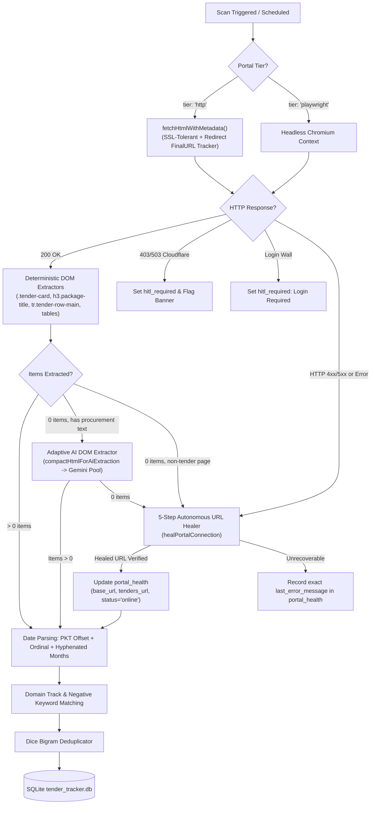

# 05. Portals Catalog & Self-Healing Scraping Architecture

## The 18 Pakistan Procurement Portals

Tender Tracker catalogs 18 official and aggregator procurement portals across Pakistan, categorized into 5 operational sectors:

| ID | Portal Name | Category | Tier | Access Mode | Default Tenders URL | Scraping Strategy & Operational Status |
|---|---|---|---|---|---|---|
| `epads` | Federal PPRA (EPMS / EPADS) | Regulatory | `playwright` | `login_required` | `https://epms.ppra.gov.pk/` | Statutory federal electronic procurement portal. Main notice board is public; bidding document downloads require operator login credentials. |
| `punjab_eproc` | Punjab PPRA | Regulatory | `http` | `public` | `http://eproc.punjab.gov.pk/ActiveTenders.aspx` | Highest volume provincial source (865+ active tenders). Scraped via Cheerio with toleration for ASP.NET postback tables. |
| `sppra` | Sindh SPPRA | Regulatory | `playwright` | `public` | `https://portalsindh.eprocure.gov.pk` | Dynamic portal indexing 12,000+ listings. Headless Playwright context renders DOM before extraction. |
| `kppra` | Khyber Pakhtunkhwa KPPRA | Regulatory | `playwright` | `offline_broken` | `https://kp.eprocure.gov.pk` | KP EPADS portal protected by basic-auth challenge; health probe tracks connectivity without interrupting crawls. |
| `bppra` | Balochistan BPPRA | Regulatory | `http` | `public` | `https://bpptwo.vdc.services:5451/Tenders` | Balochistan ePPS portal (80+ active tenders). Resolved from `bppra.gob.pk` redirect; parsed via multi-row (`tr.tender-row-main` + sibling `tr.tender-row-dates`) extractor. |
| `ndma` | National Disaster Management Authority (NDMA) | Federal/Regional | `http` | `public` | `https://ndma.gov.pk/tenders` | Emergency procurement and disaster relief infrastructure (scraped via `.tender-card` DOM extractors). |
| `fde` | Federal Directorate of Education (FDE) | Federal/Regional | `http` | `public` | `https://fde.gov.pk/download-category/tender/` | Islamabad school solarization, furniture, and educational supplies (scraped via `h3.package-title`). |
| `mofept` | Ministry of Federal Education & Professional Training | Federal/Regional | `http` | `public` | `https://mofept.gov.pk/Tenders` | Federal education ministry active tenders with server-side search parsing. |
| `gilgit` | Government of Gilgit-Baltistan | Federal/Regional | `http` | `offline_broken` | `https://gilgitbaltistan.gov.pk` | Regional portal lacks dedicated public tenders directory; handled gracefully by crawler. |
| `pseb` | Pakistan Software Export Board (TechDestination) | Tech & Skills | `http` | `public` | `https://techdestination.com/tenders/` | Rebranded to TechDestination; extracts tender notices and attached bidding PDFs. |
| `ignite` | Ignite National Technology Fund | Tech & Skills | `http` | `public` | `https://ignite.org.pk/procurement/` | National innovation and startup incubators procurement tab. |
| `psdf` | Punjab Skills Development Fund (PSDF) | Tech & Skills | `http` | `public` | `https://psdf.org.pk/procurement` | Apex TVET and skills training procurement listings (scraped via `.inner-advertisement-listing-box`). |
| `psda` | Punjab Skills Development Authority (PSDA) | Tech & Skills | `http` | `public` | `https://psda.punjab.gov.pk/tenders` | Regulatory vocational authority tender board. |
| `peef` | Punjab Educational Endowment Fund (PEEF) | Tech & Skills | `http` | `public` | `https://peef.org.pk/tenders` | Educational supplies and IT consumables handled via tolerant SSL HTTPS agent. |
| `ungm` | United Nations Global Marketplace (UNGM) | Multilateral | `playwright` | `public` | `https://www.ungm.org/Public/Notice` | UN agencies procurement for Pakistan operations (1,700+ live global notices). |
| `giz` | Deutsche Gesellschaft für Internationale Zusammenarbeit (GIZ) | Multilateral | `http` | `public` | `https://www.giz.de/en/workingwithgiz/bidding_procurement.html` | German international development cooperation country tenders. |
| `tender_services` | Tender Services Pakistan | Aggregator | `playwright` | `login_required` | `https://tenderservice.pk` | Commercial aggregator consolidating nationwide notices. Automated login at `https://tenderservice.pk/permits/login.php` with cookie capture. |
| `pid` | Press Information Department / Gazettes (PID) | Aggregator | `http` | `public` | `https://pid.gov.pk` | Federal government statutory gazette advertisements and tender releases. |

---

## Self-Healing Scraping Pipeline

### 1. Deterministic Multi-Pattern DOM Extractors (`parsePortalHtml`)
Before invoking any AI model, `parsePortalHtml()` executes fast Cheerio-based structural extractors tailored to Pakistani procurement portals:
- **NDMA Cards (`.tender-card`)**: Extracts `.tender-card__title`, `[data-label*="Submission"]`, `[data-label*="Opening"]`, and attached PDFs.
- **WordPress Download Manager (`h3.package-title`)**: Used by FDE; strips leading date prefixes from package titles and extracts card metadata.
- **PSDF Listing Boxes (`.inner-advertisement-listing-box`)**: Extracts `h4/.listingadver-title1` and notice image attachments.
- **BPPRA ePPS Multi-Row Tables (`tr.tender-row-main` + sibling `tr.tender-row-dates`)**: Groups `rowspan="3"` rows together so the `TSE-...` reference number, title, procuring agency, budget, document links (`Bidding Document`, `NIT Document`, `BOQ Document`), and sibling `Publish:` / `Dead Line:` dates are combined into a single clean tender record.
- **Standard Tables & Elementor PDF Directories**: Parses Drupal views, ASP.NET GridViews, and direct PDF procurement links while filtering out generic button labels (`Download`, `Click to view`, `Bidding Document`, `NIT Document`, `BOQ Document`).

### 2. Adaptive AI HTML Layout Extraction (Phase 2 Zero-Yield Recovery)
When a portal redesigns its HTML template (e.g., switches from `<table>` to custom `
` grids or Blazor/React components) such that `parsePortalHtml()` returns `0` items on an HTTP 200 page:
1. **Signal Verification (`hasProcurementSignals`)**: Confirms the page contains genuine procurement vocabulary (`tender`, `procurement`, `rfp`, `bid`, `nit`, `deadline`) and is not an explicit empty state (`"No active tenders"`).
2. **Link-Preserving DOM Compaction (`compactHtmlForAiExtraction`)**: Strips `<script>`, `<style>`, `<svg>`, `<nav>`, `<footer>`, and `<header>`, converts `<a href="...">Label</a>` into inline `[Label](resolvedUrl)` markdown so download and detail links are retained, and compacts whitespace to $\le 25,000$ characters.
3. **Structured Gemini Extraction (`extractTenderListFromHtmlWithAI`)**: Sends the compacted digest to the 4-model Gemini failover chain (`gemini-flash-lite-latest` $\rightarrow$ `gemini-3.1-flash-lite` $\rightarrow$ `gemini-3.5-flash` $\rightarrow$ `gemini-3.8-flash`) and validates each returned tender item.

### 3. Five-Step Autonomous URL Discovery & Self-Healing (`healPortalConnection`)
When a configured `tenders_url` returns an HTTP error (such as `HTTP 404` or `HTTP 500` when an agency restructures its website) or lands on a generic homepage with `0` tenders, the scraper automatically executes the operator's 5-step discovery workflow:
1. **Step 1 — Identify Organization Root**: Derives candidate root URLs from `portal.baseUrl` and `new URL(portal.tendersUrl).origin`.
2. **Step 2 — Open Official Website (Redirect-Aware)**: Fetches the root domain via `fetchHtmlWithMetadata()`, following cross-domain and custom-port redirects (e.g., `https://bppra.gob.pk` $\xrightarrow{301}$ `https://bpptwo.vdc.services:5451/`) to capture `finalRootUrl`.
3. **Step 3 — Look for the "Tenders" Button**:
   - **Heuristic Link Scorer (`scoreCandidateTenderLinks`)**: Evaluates all `<a href>` elements on the homepage, awarding `+10` for tender/procurement anchor text, `+4` for exact button labels (`Tenders`, `Active Tenders`, `Procurement`, `Bids`), and `+5` for URL path slugs (`/Tenders`, `/procurement`, `/active-tenders`), while applying `-15` penalties to archive, rules, login, and social/map links.
   - **AI Navigation Fallback (`discoverTenderLinkWithAI`)**: If no link scores $\ge 5$, passes the homepage navigation links to Gemini to pick the top candidate URLs.
4. **Step 4 — Open & Verify Candidate Portal**: Fetches the top candidate URLs (resolved against `finalRootUrl`) and verifies that deterministic or AI extraction yields active tenders (or a confirmed empty procurement table).
5. **Step 5 — Save the Healed Portal Address**: Updates `base_url`, `tenders_url`, `status = 'online'`, and `verified_status = 'Auto-healed -> <url>'` in SQLite `portal_health` so all future scans use the healed address automatically.

---

## Friction Resolution & Human-in-the-Loop (HITL)

When a portal deploys Cloudflare Turnstile, CAPTCHA bot protection, or requires manual multi-factor verification:
1. **Challenge Detection**:
   The crawler inspects HTTP response codes (403/503) and HTML content for Cloudflare markers (`cf-browser-verification`, `Turnstile`, `challenges.cloudflare.com`).
2. **Flagging & Explicit Failure Reason**:
   The portal's status in `portal_health` is set to `hitl_required`, and the exact reason (`Verification challenge detected` or `Login credentials or active session required`) is displayed in the **Sources > Portals** list.
3. **One-Click Resolution**:
   The operator clicks **"Launch HITL Browser"** from the UI. A visible Chromium window opens to the target URL. Once solved, harvested cookies are saved to `data/sessions/<portalId>/cookies.txt` and the portal returns to `online`.
