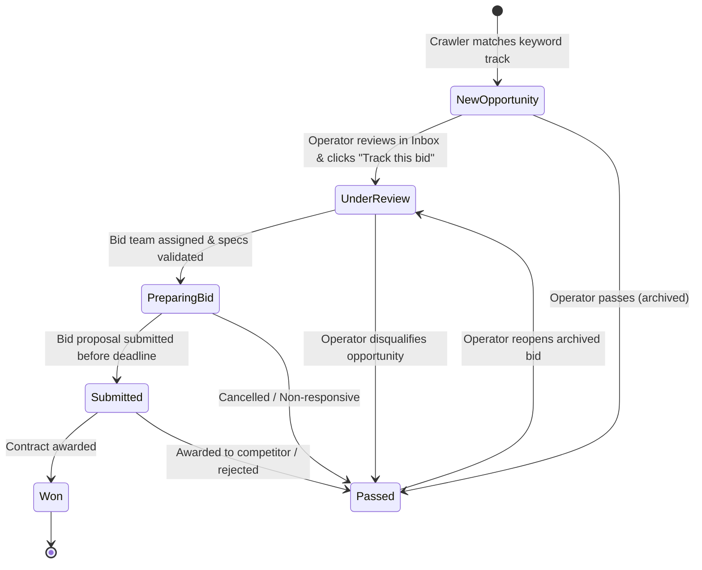
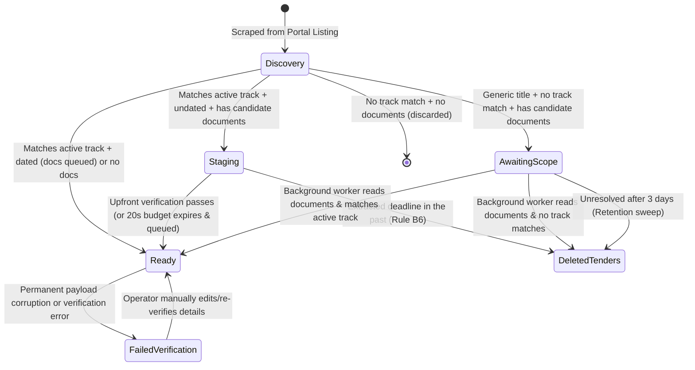

# 06. Bid Pipeline & Opportunity Lifecycle

## Opportunity Lifecycle Stages

Every scraped tender moves through a deterministic, auditable state machine governed by the six defined `TENDER_STATUSES`:

---

## Ingestion Status Lifecycle (`ingestion_status`)

Before a tender reaches the active pipeline, its intake is governed by `ingestion_status` (`src/server/db/schema.ts`):

### Ingestion Status Rules & Invariants
1. **`staging`**:
   - Temporary holding status during upfront document downloading and deadline verification (max 20-second budget per tender).
   - Rows in `staging` are strictly hidden from the Inbox, Pipeline, and KPI banners.
   - If upfront verification completes or times out, the row transitions to `ready` (with remaining documents deferred to `document_ingest_jobs`).
   - If the server process terminates mid-fetch, the retention daemon (`retention.ts`) automatically auto-releases any `staging` row older than 60 minutes to `ready` (`RET-8`).
2. **`awaiting_scope`**:
   - Used for notices with generic non-informative titles (e.g., *"Tender Notice"*, *"Corrigendum"*, *"Notice Inviting Tender"*) whose listing text matches no active domain track, but which contain attached PDF/Word documents.
   - Held invisibly while the background queue worker reads up to 2 documents via `applyDocumentScopeToTracks` (`MATCH-2`).
   - If document text matches a track, the row transitions to `ready` and surfaces in the Inbox.
   - If document text confirms no track match, the row is deleted with `reason = 'no-track-match'` and suppressed.
   - Any `awaiting_scope` record unresolved after 3 days is permanently purged by retention (`MATCH-4`).
3. **`ready`**:
   - The canonical visible status for all verified opportunities. Only tenders with `ingestion_status = 'ready'` appear in the Inbox and Pipeline.
4. **`failed_verification`**:
   - Retained for rare unrecoverable document payload corruptions or operator-quarantined notices.
5. **Re-scan Immutability**:
   - When a crawler re-visits an already-stored tender, it takes the **Re-scan Path**. An existing tender **NEVER** transitions back to `staging` or `awaiting_scope` (`ID-2`, `ID-3`).

### Stage Definitions

1. **`New Opportunity` (Inbox)**:
   Default stage for incoming tenders discovered by the scraper that matched at least one active domain track. The tender remains in the Inbox until the operator takes action.
2. **`Under Review` (Pipeline)**:
   The operator has flagged the tender as commercially viable. The technical specifications, eligibility criteria, and delivery dates are undergoing evaluation.
3. **`Preparing Bid` (Pipeline)**:
   Active proposal drafting stage: procuring bid bonds, preparing technical envelopes, costing bill of quantities (BOQ), and completing compliance sheets.
4. **`Submitted` (Pipeline)**:
   The bid has been formally delivered (physically by courier or electronically via e-Procurement / EPMS). The tender awaits opening and technical evaluation.
5. **`Won` (Pipeline)**:
   Contract awarded to Ahsan Abdullah / operating entity. Successfully closed opportunity.
6. **`Passed` (Archive)**:
   Tenders that were disqualified, unviable, cancelled by the procuring authority, or lost. Passed records are excluded from active board views but preserved with notes for historical intelligence.

---

## Kanban Board & Gantt Timeline Views

The **Pipeline** screen offers two complementary perspectives:

### 1. Board View (Kanban)
Displays active bids organized into columns by stage:
- **Elapsed Progress Bar**: Shows visual indicator of time elapsed between notice publication and closing deadline. Changes to a red danger bar when deadline is within 24 hours.
- **Corrigendum Badge**: Highlights tenders that have active unacknowledged amendments.
- **Instant Actions**: One-click slideover opening, stage progression, bookmarking, and notes entry.

### 2. Gantt Timeline View
Plots tenders along a 5-week horizon starting from the current Monday in PKT:
- **Closing Date Diamond**: Plots closing deadline directly against the time axis.
- **Result Expected Interval**: Displays projected milestone bar from notice discovery to anticipated award date (`result_expected_date`).
- **Vertical "Today" Line**: Real-time current day marker in Pakistan Standard Time.

---

## Corrigenda Detection, Provenance Badges & Operator Review Flags

When government agencies issue amendments or when documents are read during ingestion:
1. **Deadline Provenance Badges (`deadlineProvenance` in `src/client/components/inbox/Detail.tsx`)**:
   - Every tender card and detail panel in both the **Inbox** and **Pipeline** surfaces where its closing deadline came from:
     - `Verified from corrigendum` (`corrigendum_doc`)
     - `Verified from tender document` (`primary_doc`)
     - `Portal listing date` (`html_row` / `html_detail`)
     - `No deadline · Portal HTML only` (undated listing with no documents)
     - `Fetching documents in the background…` (`doc_fetch_status = 'pending'`)
2. **Corrigenda Extension Logging**:
   - When a later deadline is discovered on a re-scan or in a corrigendum document, a new entry is written to `corrigendum_logs` and `has_corrigendum` is set to `1`.
3. **Operator Review Flags (`needs_review = 1`)**:
   - When a corrigendum or re-scan moves a deadline to an earlier calendar day (`deadline_moved_earlier`), cancels a tender (`corrigendum_cancelled`), suggests an uncertain past deadline (`uncertain_past_deadline`), or introduces excluded terms in attachments (`excluded_terms_in_documents`), the tender is flagged with `needs_review = 1`.
   - Flagged tenders sort to the top of both the **Inbox** and their **Pipeline** stage column, display a red `Review` chip, and are protected from automatic retention expiry until the operator clicks **Confirm** (`PATCH /api/tenders/:id/review`) or **Pass** / **Pass as cancelled**.

---

## Ingestion Order, Deduplication & Pipeline Safety Invariants

### 1. Re-scan Identity Path First (`src/server/scrapers/ingestPipeline.ts`)
Whenever a crawler visits a portal:
1. It calculates the deterministic `tenderId`.
2. It checks if the tender already exists in SQLite:
   - If it exists: It takes the **Re-scan Path**. It NEVER switches the row to `staging`, NEVER deletes the row, and NEVER overwrites pipeline statuses (`Under Review`, `Preparing Bid`, `Submitted`, `Won`, `Passed`) or operator `status_notes`.
   - Deadline updates are evaluated exclusively by `applyRescannedDeadline` (`src/server/scrapers/ingestPipeline.ts`):
     - Extended deadline (later PKT day) → updates `closing_date`, sets `has_corrigendum = 1`, and logs a `deadline_extension` corrigendum.
     - Earlier deadline (earlier PKT day) → preserves current deadline, sets `needs_review = 1` with reason `deadline_moved_earlier`.
     - Same calendar day → no deadline change.
   - Newly discovered document links (excluding URLs already cached in `cached_dossiers`) are appended to `attachment_urls` and queued for download; dedicated detail pages (`epms_ppra` and `fde`) with no cached documents queue a `DETAIL_DISCOVER_LABEL` discovery job.

### 2. Automatic Document Fetching & Queue Priority Tiers (`src/server/db/repositories/ingestJobsRepo.ts` & `src/server/services/ingestWorker.ts`)
- **Non-Blocking Scan Intake**: Only undated matched notices (`!closingDate`) block during the crawl (`staging`) to verify Rule `B6`. Dated tenders insert immediately as `ready` with their documents queued so scans never stall on large PDF batches.
- **Strict Priority Order (`claimDueJobs`)**:
  1. **Tier 0**: Bookmarked or actively tracked `ready` tenders (`Pipeline` stages or `is_bookmarked = 1`).
  2. **Tier 1**: Open `ready` Inbox tenders ordered by **soonest open closing deadline** (`closing_date ASC`), then per-document priority (`corrigendum` $\rightarrow$ `primary`/URLs containing `BiddingDocuments` $\rightarrow$ `other`).
  3. **Tier 2**: Hidden `awaiting_scope` listings awaiting track classification.
- **Fast Post-Scan Drain & Smart Throttle (`drainDocumentQueue`)**: Runs automatically as soon as any crawl finishes (plus 4s after startup following `releaseExpiredLeases()`, and every 2 minutes), processing up to 3 distinct tenders concurrently (sequential within each tender) across 12-job batches with local-only digital extraction (`allowAiCrossCheck: false`) until all visible `ready` Inbox/Pipeline documents are cached, broadcasting live `doc_queue_progress` and `documents_updated` SSE frames, then letting remaining `awaiting_scope` jobs trickle gently in the background.
- **On-View Auto-Fetch**: Opening a tender in the Inbox/Pipeline detail pane with `0` saved documents and a fetchable attachment or detail page automatically calls `POST /api/tenders/:id/fetch-documents` (`forceRefresh: false`) so urgent tenders appear immediately even before the background queue reaches them.
- **Unified Canonical Naming & Heading Reclassification (`dossierStore.ts` & `documentExtractor.ts`)**: Every portal download, background fetch, and manual upload uses the hash-free naming rule `{PORTAL}_{Ref_or_Title}_{DocType}-{N}{-vK}.{ext}` (`saveTenderDocument`, `generateCanonicalFilename`), infers initial document type from URL segments (`/BiddingDocuments/`, `/BOQManual/`, `/Tenders/`), upgrades `docType` and renames the file on disk via `renameDossierToCanonical` when PDF heading text identifies a `corrigendum`, `boq`, `rfp`, `tor`, or `bidding-document`, and supports startup migration (`migrateDossierFilenames`, `reclassifyExistingDossiersFromText`) plus `recheckEarlierDeadlineReviewTenders`.

### 3. "Hold for Scope" (`awaiting_scope` in `src/server/scrapers/ingestPipeline.ts`)
- Listings whose listing title/text matches no active domain track, but which contain document candidates (e.g. generic titles like *"Tender Notice"* or *"Corrigendum"* with attached PDFs), are inserted as `ingestion_status = 'awaiting_scope'` (hidden from Inbox, Pipeline, and KPIs).
- The background worker reads up to 2 documents using `applyDocumentScopeToTracks`.
- If the document text matches a track, the status is promoted to `'ready'` (appearing in the Inbox).
- If no track matches, the tender is deleted with `reason = 'no-track-match'` and suppressed. Unresolved `awaiting_scope` rows older than 3 days are cleaned up by retention.

### 4. Deduplication & Provenance Rules (`src/server/services/deduplicator.ts`)
- **Tier 1 (Strict Reference)**: Match on `reference_norm`. Requires corroborating signals (organization similarity $\ge 0.5$, title similarity $\ge 0.5$, or closing dates within 1.5 days) unless the reference is long and structured ($\ge 12$ chars with $\ge 2$ segments).
- **Tier 2 (Title Dice Similarity)**: Evaluated only against different portals (own portal is strictly excluded from duplicate candidate search). The `titlesAreDistinguishable` check prevents merging distinct procurement packages that differ by 1–2 key nouns (e.g., "Laptops" vs "Printers").
- **Secondary Sources**: The tender's own originating portal is never recorded under `secondary_sources`. Secondary source entries are unique by `direct_url`.

### 5. Slimming, Suppression & Ageing Invariants (`src/server/services/retention.ts`)
- **Slimming Passed Tenders**: Dossiers are purged from disk 2 minutes after a tender enters `Passed`. Tenders passed directly from Inbox have descriptions cleared while retaining `status_notes`. Tenders that have ever been in the Pipeline (`pipeline_audit_logs`) preserve their description, full history, and corrigenda permanently.
- **Suppression Expiry**: Undated suppressions expire after 120 days. Auto-expired suppressions are automatically lifted if a subsequent scan finds a new future closing date. User suppressions (`reason = 'user'`) are permanent.
- **Undated Ageing Limit**: Standardized to **90 days** (`UNDATED_MAX_AGE_DAYS = 90`) across ingest, retention, and Inbox UI. Publication dates inferred from upload folder paths (`publish_date_source = 'upload_folder'`) are never used for ageing; discovery timestamp `created_at` is used instead.
