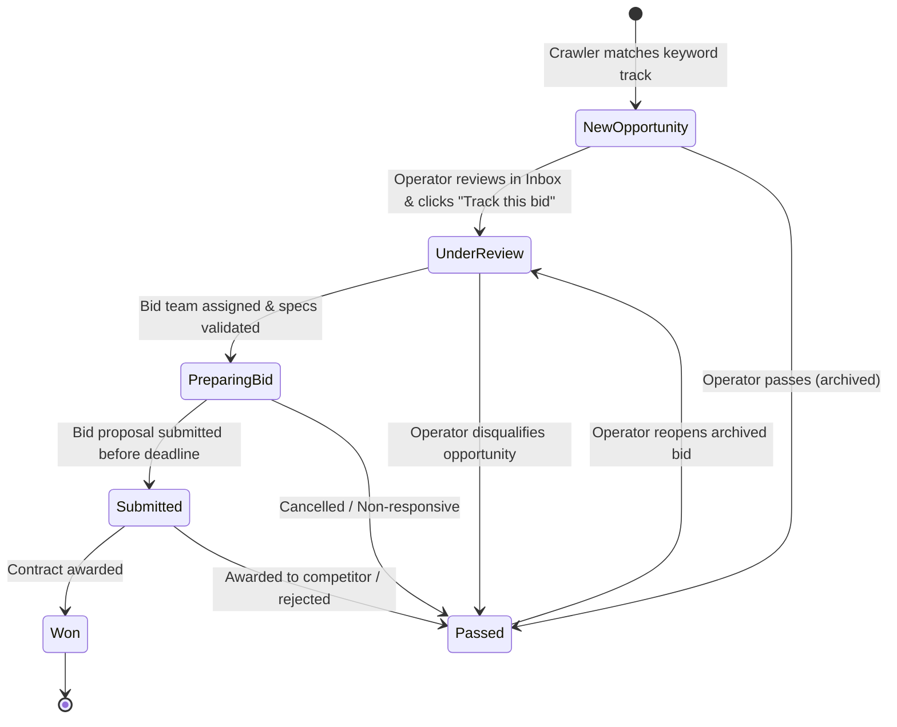

# 06. Bid Pipeline & Opportunity Lifecycle

## Opportunity Lifecycle Stages

Every scraped tender moves through a deterministic, auditable state machine governed by the six defined `TENDER_STATUSES`:

### Stage Definitions

1. **`New Opportunity` (Inbox)**:
   Default stage for incoming tenders discovered by the scraper that matched at least one active domain track. The tender remains in the Inbox until the operator takes action.
2. **`Under Review` (Pipeline)**:
   The operator has flagged the tender as commercially viable. The technical specifications, eligibility criteria, and delivery dates are undergoing evaluation.
3. **`Preparing Bid` (Pipeline)**:
   Active proposal drafting stage: procuring bid bonds, preparing technical envelopes, costing bill of quantities (BOQ), and completing compliance sheets.
4. **`Submitted` (Pipeline)**:
   The bid has been formally delivered (physically by courier or electronically via EPADS). The tender awaits opening and technical evaluation.
5. **`Won` (Pipeline)**:
   Contract awarded to Ahsan Abdullah / operating entity. Successfully closed opportunity.
6. **`Passed` (Archive)**:
   Tenders that were disqualified, unviable, cancelled by the procuring authority, or lost. Passed records are excluded from active board views but preserved with notes for historical intelligence.

---

## Kanban Board & Gantt Timeline Views

The **Pipeline** screen offers two complementary perspectives:

### 1. Board View (Kanban)
Displays active bids organized into columns by stage:
- **Elapsed Progress Bar**: Shows visual indicator of time elapsed between notice publication and closing deadline. Changes to a red danger bar when deadline is within 24 hours.
- **Corrigendum Badge**: Highlights tenders that have active unacknowledged amendments.
- **Instant Actions**: One-click slideover opening, stage progression, bookmarking, and notes entry.

### 2. Gantt Timeline View
Plots tenders along a 5-week horizon starting from the current Monday in PKT:
- **Closing Date Diamond**: Plots closing deadline directly against the time axis.
- **Result Expected Interval**: Displays projected milestone bar from notice discovery to anticipated award date (`result_expected_date`).
- **Vertical "Today" Line**: Real-time current day marker in Pakistan Standard Time.

---

## Corrigenda Detection & Acknowledgment

When government agencies issue amendments:
1. The crawler compares newly parsed closing dates and notice content with existing database entries.
2. If the date extends or scope revisions appear, a new entry is written to `corrigendum_logs`, and `has_corrigendum` is set to `1` on the tender.
3. The UI prominently displays an amber alert banner in the KPI header and on the tender card.
4. The operator can click **"Acknowledge"** to mark the amendment as reviewed.
